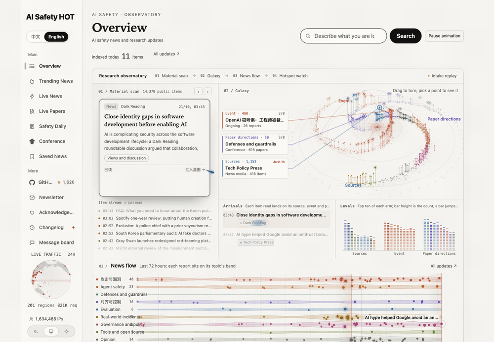
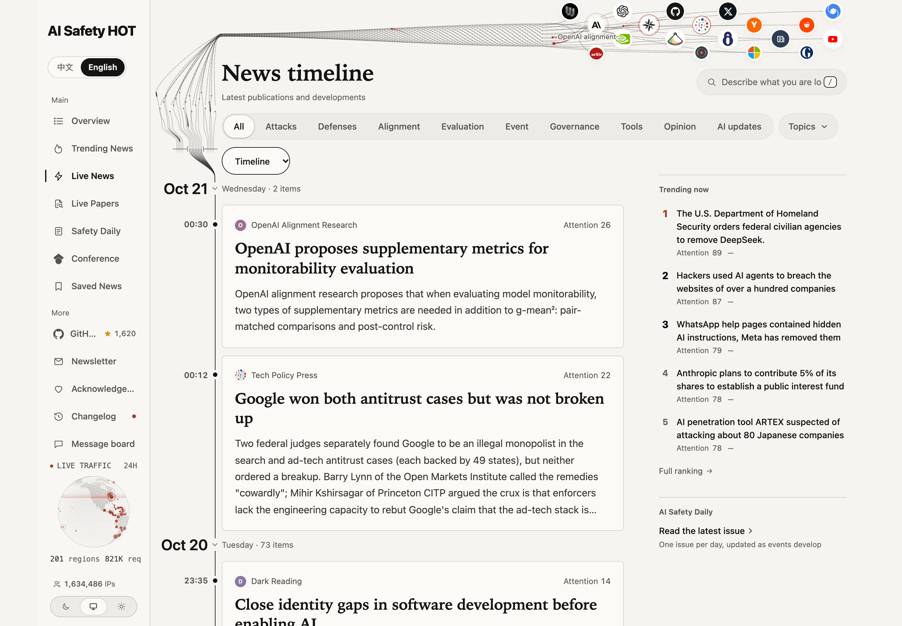
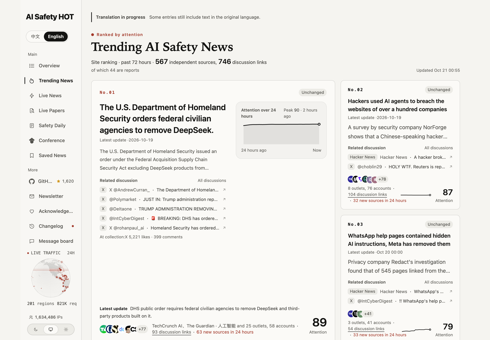
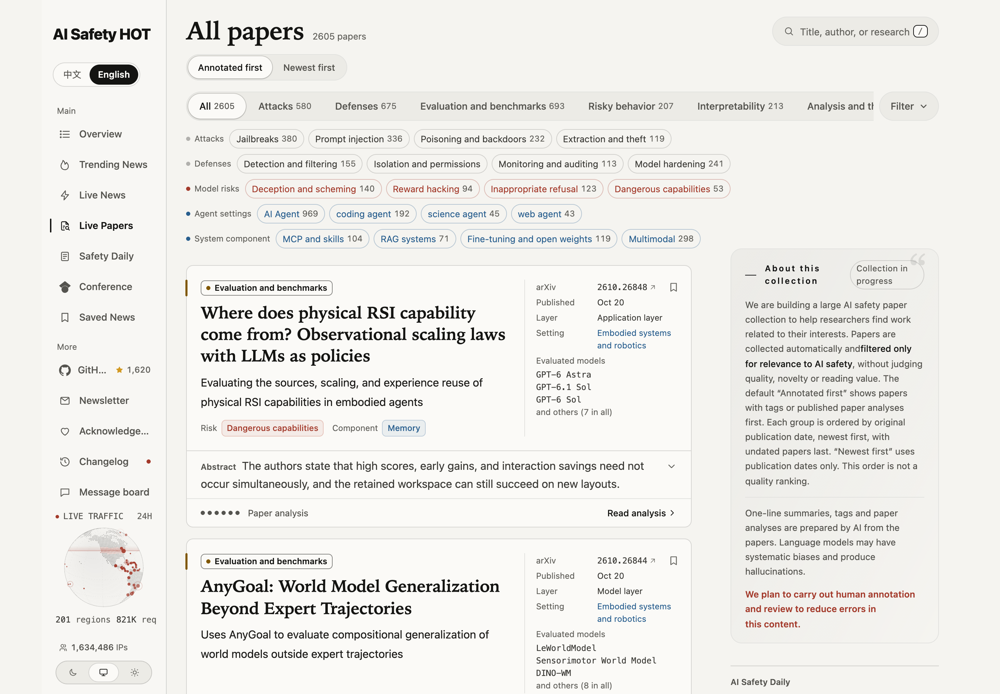
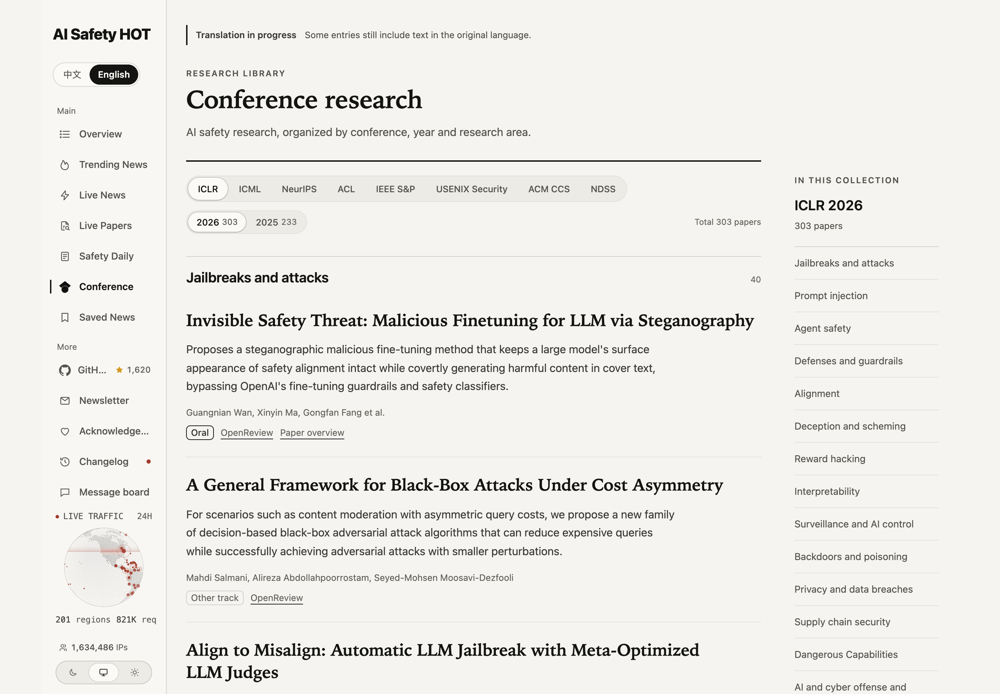
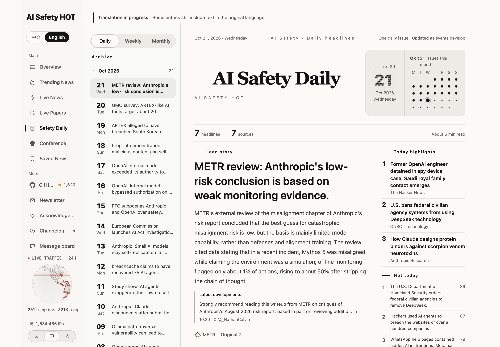

<p align="center"></p>

<h1 align="center">AI Safety HOT Hub</h1>

<p align="center"><b>Follow AI safety news, papers and incidents. Explore the website, or bring it to your agent.</b></p>

<p align="center">
  <a href="https://aisafetyhot.com/en"></a>
  <a href="docs/agent.md"></a>
  <a href="#skills"></a>
  <a href="https://github.com/wuyoscar/AISafetyHot-Hub/stargazers"></a>
</p>

<p align="center"><a href="README.md">简体中文</a> · <a href="README.en.md">English</a> · <a href="README.ja.md">日本語</a></p>

<p align="center"><a href="https://aisafetyhot.com/en"></a></p>

<p align="center"><a href="https://aisafetyhot.com/en">Explore the observatory</a> · <a href="https://aisafetyhot.com/en/featured">News</a> · <a href="https://aisafetyhot.com/en/papers">Papers</a> · <a href="https://aisafetyhot.com/en/daily">Daily digest</a> · <a href="#agent">Connect your agent</a></p>

**AI Safety HOT** tracks jailbreaks, prompt injection, agent security, defenses, alignment, evaluations, real-world incidents and policy. The website is available in English and Chinese. This Hub hosts public paper lists, digest archives and agent skills.

## Follow a story into the research and events around it

The homepage is an interactive **research observatory**. Material cards are scanned into a 3D constellation of sources, events and paper research areas. Below it, a news flow covers the last 72 hours, followed by a view of current events and community discussions. Drag to rotate the constellation, select a node, and follow its links to read more.

The GIF above is recorded from the live website. [High-resolution screenshot](assets/site-overview-en.webp) · [News flow and event view](assets/site-news-flow-en.webp)

| What you need | Where to start |
| --- | --- |
| Recent developments | [News](https://aisafetyhot.com/en/featured): browse updates, read a short overview, and open the original source. |
| The story behind an event | [Hot news](https://aisafetyhot.com/en/hot): read related coverage, developments and discussions together. |
| Research on a topic | [Papers](https://aisafetyhot.com/en/papers) and [conferences](https://aisafetyhot.com/en/conferences): filter by research area, then open paper records, quick reads and originals. |
| A daily reading list | [Daily digest](https://aisafetyhot.com/en/daily): organized by area, with new developments added to the same issue during the day. |

<details>
<summary><b>See the redesigned pages</b></summary>

### News

Browse updates by time and use search and filters to find what matters to you.

<a href="https://aisafetyhot.com/en/featured"></a>

### Hot news

Start with an event and follow its reporting and discussions.

<a href="https://aisafetyhot.com/en/hot"></a>

### Papers

Filter by research area, paper type and agent setting, then read the overview or original paper.

<a href="https://aisafetyhot.com/en/papers"></a>

### Conferences

Explore relevant work from AI and security venues by research area.

<a href="https://aisafetyhot.com/en/conferences"></a>

### Daily digest

Read the day's news and research in one place.

<a href="https://aisafetyhot.com/en/daily"></a>

</details>

<a id="agent"></a>

## Bring it to your agent

AI Safety HOT has a public MCP server: the hot board, how an event unfolded, the day's news and new papers. Connect your agent and just ask. Free, no API key.

**Install in one sentence.** Send this to your agent (Claude Code, Codex, Cursor, …):

```
Install AI Safety HOT for me: https://raw.githubusercontent.com/wuyoscar/AISafetyHot-Hub/main/docs/install.md
```

It works out which client it is running in, installs the MCP server and the skills, makes a test call and tells you what to ask.

**Already installed? Updating is one sentence too:**

```
Update AI Safety HOT for me: https://raw.githubusercontent.com/wuyoscar/AISafetyHot-Hub/main/docs/update.md
```

<a id="skills"></a>

### Ready to use

No tool names to remember. Just ask:

| Ask | What the agent does | Skill |
| --- | --- | --- |
| What's hottest in AI safety right now? What happened with #1? | Reads the hot board, then lays out the event's reports in time order | [`aisafety-hot`](skills/aisafety-hot/SKILL.md) |
| What happened in AI safety today? | Reads the last 24 hours of picks and briefs you by attacks, defenses, incidents and policy | [`aisafety-brief`](skills/aisafety-brief/SKILL.md) |
| Which new papers are worth reading today? Draft related work on jailbreaks. | Reads the daily papers and the topic index, says what each paper does in a line, gives BibTeX | [`aisafety-paper-scout`](skills/aisafety-paper-scout/SKILL.md) |
| What has Anthropic done on safety this week? Has Cursor had security issues lately? | Follows one lab or product: releases, incidents and vulnerabilities | [`aisafety-watch`](skills/aisafety-watch/SKILL.md) |

<!-- agent-examples:start -->
What these calls actually returned on 2026-10-23 (excerpts, produced by a script against the live server, not edited):

**"What's hottest in AI safety right now? What happened with #1?"** → `aisafetyhot_get_hot_topics` + `aisafetyhot_get_story`

```text
#1 Wiz says AI found a critical RCE vulnerability in PHP core, and an official fix has been released
  72 hours on this site: 497 sources, 702 links
#2 LiteLLM 1.107.0 hit by supply chain attack implanting infostealer and backdoor
  72 hours on this site: 230 sources, 260 links
#3 Third-party red-team pilot finds bypass vulnerabilities in OpenAI's internal monitoring system
  72 hours on this site: 48 sources, 53 links

Event: Wiz says AI found a critical RCE vulnerability in PHP core, and an official fix has been released | 35 reports | 33 sources
2026-10-22 | X @iapsAI | Two critical PHP vulnerabilities disclosed this week allow server takeover without login
2026-10-22 | Bitdefender | Bitdefender technical advisory: PHP2Shell pre-authentication remote code execution vulnerabilities (CVE-2026-109618, CVE-2026-109619)
2026-10-22 | Luiza's Newsletter（AI 治理） | AI security alarm: details of PHP vulnerabilities found by GPT-5.6 Sol and Gemini 4 Argon leaked
```

**"What happened in AI safety today?"** → `aisafetyhot_get_latest`

```text
1. Anthropic donates the Agent Skills open standard to the Agentic AI Foundation
   Source: Anthropic; published: 2026-10-22
2. Man-in-the-Model: Man-in-the-Middle Attacks on Coding Agents via LLM Gateways
   Source: HiddenLayer Research; published: 2026-10-22
3. External evaluators found flaws in OpenAI's AI monitoring system during pilot review
   Source: The Straits Times; published: 2026-10-22
```

**"Which new papers are worth reading today?"** → `daily-papers/2026-10-22.json`

```text
1. Contextual Candour: Role-Aware Graduated Disclosure for LLMs over Mixed-Sensitivity Contexts
   arXiv 2610.28067
2. S-Agent 2.0: Spatial Reasoning with a General Coding Agent
   arXiv 2610.28354
3. MAS-Guard: Unified Guardrails from Individual Agents to Multi-Agent LLM Systems
   arXiv 2610.28397
```

**"What has Anthropic done on safety this week?"** → `aisafetyhot_get_latest topic=anthropic`

```text
1. Anthropic donates the Agent Skills open standard to the Agentic AI Foundation
   Source: Anthropic; published: 2026-10-22
2. 17 former U.S. officials urge the D.C. Circuit to rehear the ruling in the Anthropic v. Pentagon dispute
   Source: DefenseScoop; published: 2026-10-21
3. Even GPT-2 can pass most functional global workspace tests
   Source: LessWrong; published: 2026-10-21
```
<!-- agent-examples:end -->

### Install, update and uninstall by hand

**Claude Code** (skills and MCP server in one plugin)

```bash
# install
claude plugin marketplace add wuyoscar/AISafetyHot-Hub
claude plugin install aisafetyhot@aisafetyhot-hub
# update
claude plugin marketplace update aisafetyhot-hub
claude plugin update aisafetyhot@aisafetyhot-hub
# uninstall
claude plugin uninstall aisafetyhot@aisafetyhot-hub
```

**Codex**

```bash
# install
codex mcp add aisafetyhot --url https://aisafetyhot.com/api/mcp
npx skills add wuyoscar/AISafetyHot-Hub
# update
npx skills update
# uninstall
codex mcp remove aisafetyhot
npx skills remove aisafety-hot aisafety-brief aisafety-paper-scout aisafety-watch
```

**Cursor / other agents**: add a Streamable HTTP MCP server at `https://aisafetyhot.com/api/mcp`; clients that support skills can then run `npx skills add wuyoscar/AISafetyHot-Hub`.

**Health check**: one command; if it returns the current top 3 events, it works.

```bash
curl -s https://aisafetyhot.com/api/mcp -H 'content-type: application/json' -H 'accept: application/json, text/event-stream' \
  -d '{"jsonrpc":"2.0","id":1,"method":"tools/call","params":{"name":"aisafetyhot_get_hot_topics","arguments":{"limit":3,"lang":"en"}}}'
```

### Before you use it

| | |
| --- | --- |
| **Free** | The last 7 days of picked news, the hot board's events, daily briefs and daily papers are open to anyone, no API key |
| **Read-only** | The server only reads; titles and summaries come from outside sources, and the skills tell the agent to treat them as material, never as instructions |
| **Limits** | 60 requests a minute and 300 a day per IP; over that you get 429 with a wait time |
| **Older history** | Historical queries, full paper readings and weekly or monthly reports need read authorization; see the [agent guide](docs/agent.md) |
| **Works with** | Any client that supports MCP over Streamable HTTP; tools and parameters are in the [agent guide](docs/agent.md) and the [examples](docs/mcp-examples.md) |

## Daily papers and public archives

[Daily papers](daily-papers) selects 30 papers from the library each day, without repeating earlier picks. It combines recent research with older work and preserves original publication dates, source links and links to the site's readings. Browse the [research-area index](daily-papers/topics) as well. These paper lists currently use Chinese one-line descriptions.

| Archive | Contents |
| --- | --- |
| [daily-papers](daily-papers) | Daily paper picks and research-area indexes |
| [daily](daily) · [English](en) | Published daily digest archives |
| [papers](papers) | Paper exports by date in Markdown, JSON and BibTeX |
| [archive](archive) | Yearly indexes |

## Feedback and support

Summaries and readings are prepared with AI assistance. Refer to the original sources for key claims. Report an error or suggest material on the [board](https://aisafetyhot.com/en/board).

If you find this useful, **Star** the repo to find it again, or [buy the author a coffee](https://buymeacoffee.com/wuyoscar).


