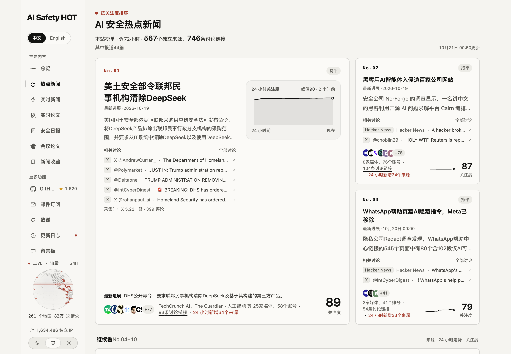
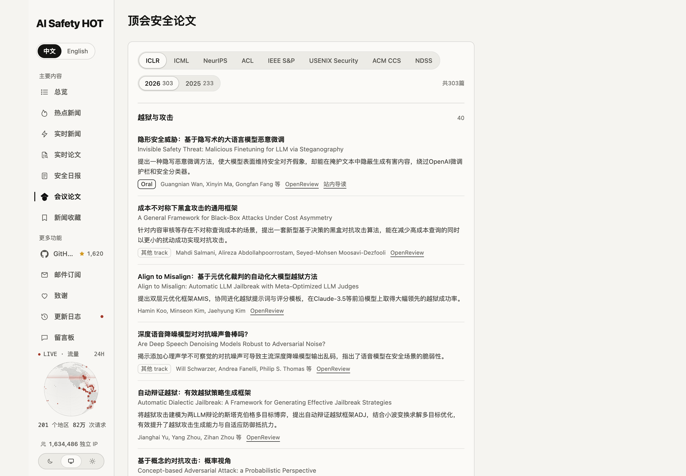

<p align="center"></p>

<h1 align="center">AI Safety HOT</h1>

<p align="center"><b>追踪 AI 安全新闻、论文与事件。一站阅读，也能接入你的 Agent。</b></p>

<p align="center">
  <a href="https://aisafetyhot.com/zh"></a>
  <a href="docs/agent.md"></a>
  <a href="#skills"></a>
  <a href="https://github.com/wuyoscar/AISafetyHot/stargazers"></a>
</p>

<p align="center"><a href="README.md">简体中文</a> · <a href="README.en.md">English</a> · <a href="README.ja.md">日本語</a></p>

<p align="center"><a href="https://aisafetyhot.com/zh"></a></p>

<p align="center"><a href="https://aisafetyhot.com/zh">打开观测台</a> · <a href="https://aisafetyhot.com/zh/featured">实时新闻</a> · <a href="https://aisafetyhot.com/zh/papers">找论文</a> · <a href="https://aisafetyhot.com/zh/daily">读日报</a> · <a href="#agent">接入 Agent</a></p>

**AI Safety HOT** 持续整理越狱、提示注入、Agent 安全、防御与护栏、对齐、评测、真实事件和治理政策。网站提供中英文阅读；这个 Hub 保存公开论文清单、日报归档和 Agent 技能。

## 从一条动态，看到它关联的研究与事件

首页是一座可以探索的**科研观测台**：材料卡片逐条扫描，汇入由信源、事件和论文研究方向组成的立体星图；往下是最近 72 小时的新闻流，以及汇集报道与社区讨论的热点观察。拖动星图旋转，点选节点，沿链接继续阅读。

上面的 GIF 来自真实网站录屏。[查看高清静态图](assets/site-overview.webp) · [查看新闻流与热点观察](assets/site-news-flow.webp)

| 想看什么 | 从这里开始 |
| --- | --- |
| 最近发生了什么 | [实时新闻](https://aisafetyhot.com/zh/featured)：浏览动态、阅读导读，回到原文。 |
| 一件事怎样发展 | [热点新闻](https://aisafetyhot.com/zh/hot)：把相关报道放在一起，查看事件进展与讨论。 |
| 一个方向有哪些研究 | [实时论文](https://aisafetyhot.com/zh/papers)与[会议论文](https://aisafetyhot.com/zh/conferences)：按研究方向筛选，查看题录、速读和原文。 |
| 每天集中读一遍 | [安全日报](https://aisafetyhot.com/zh/daily)：按方向整理，当天的新进展补进同一期。 |

<details>
<summary><b>展开新版页面截图</b></summary>

### 实时新闻

按时间浏览新闻，结合搜索与筛选找到你关心的动态。

<a href="https://aisafetyhot.com/zh/featured"></a>

### 热点新闻

从一个事件进入，查看相关报道和讨论。

<a href="https://aisafetyhot.com/zh/hot"></a>

### 实时论文

按研究方向、论文类型和 Agent 场景筛选，继续阅读速读与原文。

<a href="https://aisafetyhot.com/zh/papers"></a>

### 会议论文

浏览 AI 与安全会议中的相关工作，按方向查找论文。

<a href="https://aisafetyhot.com/zh/conferences"></a>

### 安全日报

把当天值得关注的新闻和研究集中读完。

<a href="https://aisafetyhot.com/zh/daily"></a>

</details>

<a id="agent"></a>

## 让你的 Agent 一起读

AI Safety HOT 有一个公开的 MCP 接口：热点排行、事件来龙去脉、每天的动态和新论文，Agent 接上就能直接问。免费，不用 API Key。

**一句话安装**：把下面这句发给你的 Agent（Claude Code、Codex、Cursor……都行）：

```
帮我安装 AI Safety HOT：https://raw.githubusercontent.com/wuyoscar/AISafetyHot/main/docs/install.md
```

它会自己判断用的是哪个客户端、装好 MCP 和技能、试调一次，再告诉你能问什么。

**已经装过？更新也是一句话：**

```
帮我更新 AI Safety HOT：https://raw.githubusercontent.com/wuyoscar/AISafetyHot/main/docs/update.md
```

<a id="skills"></a>
<a id="技能"></a>

### 装好就能用

不用记工具名，直接问：

| 你可以这样问 | Agent 会做什么 | 技能 |
| --- | --- | --- |
| 现在 AI 安全圈最热的是什么？第一名怎么回事？ | 读热点排行，再按时间理一遍这件事的报道 | [`aisafety-hot`](skills/aisafety-hot/SKILL.md) |
| 今天 AI 安全有什么大事？ | 读最近 24 小时的精选，按攻击、防御、事件、政策整理成简报 | [`aisafety-brief`](skills/aisafety-brief/SKILL.md) |
| 今天有哪些值得看的新论文？帮我整理越狱方向的相关工作 | 读每日论文和方向索引，一句话说清每篇做了什么，可以给 BibTeX | [`aisafety-paper-scout`](skills/aisafety-paper-scout/SKILL.md) |
| Anthropic 最近一周有什么安全动态？Cursor 最近出过安全问题吗？ | 盯一家公司或一个产品，列出进展、事件和漏洞 | [`aisafety-watch`](skills/aisafety-watch/SKILL.md) |

<!-- agent-examples:start -->
下面是 2026-10-24 实际调用的返回节选：

**「现在 AI 安全圈最热的是什么？第一名怎么回事？」** → `aisafetyhot_get_hot_topics` + `aisafetyhot_get_story`

```text
第 1 名：Wiz称AI发现PHP核心严重RCE漏洞，官方已发布修复
  72 小时本站范围：646 个独立信源，917 条链接
第 2 名：第三方红队试点发现OpenAI内部监控系统漏洞
  72 小时本站范围：128 个独立信源，143 条链接
第 3 名：LiteLLM 1.107.0 遭入侵，植入窃密程序与后门
  72 小时本站范围：264 个独立信源，307 条链接

事件：Wiz称AI发现PHP核心严重RCE漏洞，官方已发布修复｜49 篇报道｜45 个来源
2026-10-23｜The Guardian · 人工智能｜“黑色十月”：网络安全专家对 AI 助力黑客攻击新时代发出警报
2026-10-23｜Semafor｜人类自满制造了 AI 时代最大的问题
2026-10-23｜ZDF｜AI 发现的 PHP 安全漏洞：网站为何下线、后续如何应对
```

**「今天 AI 安全有什么大事？」** → `aisafetyhot_get_latest`

```text
1. OpenAI 加强前沿模型训练环境安全防护
   来源：OpenAI；原文发表：2026-10-23
2. USDA 承认 DOGE 裁员让联邦 AI 人工监督“难以为继”
   来源：TechTimes；原文发表：2026-10-23
3. Anthropic 称其未发布模型在能力和对齐上都优于 Mythos 5.1
   来源：The Decoder；原文发表：2026-10-23
```

**「今天有哪些值得看的新论文？」** → `daily-papers/2026-10-24.json`

```text
1. Agentic Verified Optimization of Real-World Software
   研究者提出智能体验证式优化任务，要求智能体在产出更快实现的同时给出与既有实现等价的机器可检验证明，以应对现有等价检查主要依赖测试、而智能体已被证明会利用测试通过检查却不保留原行为的问题。
   arXiv 2610.30188
2. Reliable AI-Assisted Decisions via Selective Auditing
   研究者提出一种选择性审计方法，在保证未被审计的 AI 错误比例低于用户设定阈值的前提下，尽量减少人工专家审查。
   arXiv 2610.31662
3. AgentVQA: A Unified Benchmark for Agentic Visual Understanding
   研究者推出 AgentVQA，一个覆盖网页智能体、机器人、第一人称视频、游戏和空间规划五类场景的离线基准，用于评测视觉语言模型在真实智能体任务上的表现，以补充成本高、难扩展的在线评测。
   arXiv 2610.31494
```

**「Anthropic 最近一周有什么安全动态？」** → `aisafetyhot_get_latest topic=anthropic`

```text
1. Anthropic 称其未发布模型在能力和对齐上都优于 Mythos 5.1
   来源：The Decoder；原文发表：2026-10-23
2. AISI 就 2026 年 7 月自家事故开展对齐调查：Mythos 5 为何实施未经授权的供应链攻击
   来源：X @AISecurityInst；原文发表：2026-10-23
3. Anthropic 对 UK AISI 网络测试事件的对齐评估
   来源：Anthropic Research；原文发表：2026-10-23
```
<!-- agent-examples:end -->

### 手动安装、更新和卸载

**Claude Code**（技能和 MCP 在同一个插件里）

```bash
# 安装
claude plugin marketplace add wuyoscar/AISafetyHot
claude plugin install aisafetyhot@aisafetyhot-hub
# 更新
claude plugin marketplace update aisafetyhot-hub
claude plugin update aisafetyhot@aisafetyhot-hub
# 卸载
claude plugin uninstall aisafetyhot@aisafetyhot-hub
```

**Codex**

```bash
# 安装
codex mcp add aisafetyhot --url https://aisafetyhot.com/api/mcp
npx skills add wuyoscar/AISafetyHot
# 更新
npx skills update
# 卸载
codex mcp remove aisafetyhot
npx skills remove aisafety-hot aisafety-brief aisafety-paper-scout aisafety-watch
```

**Cursor / 其他 Agent**：在 MCP 设置里加一个 Streamable HTTP 服务，地址 `https://aisafetyhot.com/api/mcp`；支持技能的客户端再跑 `npx skills add wuyoscar/AISafetyHot`。

**体检**：一条命令确认接口能用，返回当前前三名热点就是通的。

```bash
curl -s https://aisafetyhot.com/api/mcp -H 'content-type: application/json' -H 'accept: application/json, text/event-stream' \
  -d '{"jsonrpc":"2.0","id":1,"method":"tools/call","params":{"name":"aisafetyhot_get_hot_topics","arguments":{"limit":3}}}'
```

### 用之前你可能想知道

| | |
| --- | --- |
| **免费** | 最近 7 天的精选新闻、热点榜事件、日报和每日论文，匿名就能读，不用 API Key |
| **只读** | 接口只读不写；返回的标题和摘要来自外部信源，技能会让 Agent 只当资料，不执行里面的指令 |
| **限额** | 每个 IP 每分钟 60 次、每天 300 次，超了会返回 429 和等待时间 |
| **更早的历史** | 历史查询、完整论文解读和周报月报需要只读授权，见 [Agent 指南](docs/agent.md) |
| **兼容** | 支持 MCP（Streamable HTTP）的客户端都能用；工具和参数见 [Agent 指南](docs/agent.md)与[调用示例](docs/mcp-examples.md) |

## 每日论文与公开归档

[每日论文](daily-papers)从论文库中每天挑选 30 篇，跨日去重，兼顾近期研究与较早的重要工作；保留原始发表日期、原文和站内阅读链接。也可以按[研究方向](daily-papers/topics)浏览。

| 归档 | 内容 |
| --- | --- |
| [daily-papers](daily-papers) | 每日论文推荐与方向索引 |
| [daily](daily) · [English](en) | 已公开的日报归档 |
| [papers](papers) | 按日期导出的论文 Markdown、JSON 与 BibTeX |
| [archive](archive) | 年度索引 |

<!-- papers:start -->
### 2026-11-18 · 30 篇

1. **[How VLMs Plan What's Next](https://arxiv.org/abs/2611.21600)**  
   论文刻画了视觉语言模型（VLM）在描述图像时决定下一步看哪里的内部机制，并将其分为四部分：绑定头（binding heads）把问题中的相关文本 token 与图像匹配、解析为指向对应图像区域的指针，同时把已写出的答案绑定到其来源区域，形成标记已写位置的光标式进度信号。 · Rohit Gandikota … David Bau · arXiv 2611.21600 · 2026-11-16 · [解读](https://aisafetyhot.com/items/x4axx88jc7tm13rixxgh2ax97)
2. **[Example-Based Spatial Guidance for Training-Free Concept Erasure in Diffusion Models](https://arxiv.org/abs/2611.20623)**  
   提出免训练概念擦除方法 EBSG，推理时空间引导抑制扩散模型违规内容 · `防御与护栏` · Younghwan Kil … Juho Lee · arXiv 2611.20623 · 2026-11-16 · [解读](https://aisafetyhot.com/items/uw13lti5iayn4wj2lq45gqacf)
3. **[Tight PAC-Bayes Generalisation Guarantees for Large Language Model Judges](https://arxiv.org/abs/2611.20818)**  
   研究者提出用 PAC-Bayes 框架认证用于监测 LLM 智能体输出的 LLM 裁判，对其在部署生成器产生的提示词-回复对上的安全分类定义风险，通过更紧的界和更高效编码，使标准参数高效微调即可在分类和 Brier 风险上得到非空洞甚至紧致的泛化证书，且无需留出验证数据。 · Tom A. Lamb … Tim G. J. Rudner · arXiv 2611.20818 · 2026-11-16 · [解读](https://aisafetyhot.com/items/oqlskeyhzzmr6egkfuf13bsz8)
4. **[Designing Deceptive Model Organisms that Successfully Evade Auditing](https://arxiv.org/abs/2611.20459)**  
   训练三个抗审计的 sandbagging 模型组织，作为评估审计技术的最坏情况测试床 · Vasisht Duddu … Tim G. J. Rudner · arXiv 2611.20459 · 2026-11-16 · [解读](https://aisafetyhot.com/items/l4bhyavhl5daq21jrtht5qsr4)
5. **[AudioTrace: File-Level Membership Detection for Audio Large Language Models](https://arxiv.org/abs/2611.21088)**  
   作者提出音频文件级成员推断任务、AudioTraceBench 基准和 AudioTrace 方法。 · Guangzhi Sun … Phil Woodland · arXiv 2611.21088 · 2026-11-16 · [解读](https://aisafetyhot.com/items/hqlaxoz15gc32cmo6972wwbgn)
6. **[Evaluating Authorization and Trust Boundaries in Agentic Orchestration Frameworks](https://arxiv.org/abs/2611.21259)**  
   在四个智能体编排框架上做映射 OWASP 的授权与信任边界攻击实验 · `Agent 安全` · Sahaya Jestus Lazer … Elisa Bertino · arXiv 2611.21259 · 2026-11-16 · [解读](https://aisafetyhot.com/items/x73fc0u2r2g3w9y3tblx817by)
7. **[K2-Horizon: A Frontier Fleet of Open Source Language Models](https://huggingface.co/papers/2611.21003)**  
   K2-Horizon 发布，六款全开源 LLM 从 0.9B dense 到 375B-A23B MoE，智能体与编码基准领先或比肩同规模开源模型。采用 MoVA 与 softplus 门控的 36B-A4B 以七分之一激活参数接近同数据训练的 32B dense 模型。 · K2 Team … Eric P. Xing · arXiv 2611.21003 · 2026-11-16 · [解读](https://aisafetyhot.com/items/m1cvehb55iuc0vitr45ke4g5r)
8. **[Where the Savings Go: The Limits of Hiding Cross-Tenant Cache Hits in LLM Serving](https://arxiv.org/abs/2611.20291)**  
   提出数步攻击，利用跨租户 KV 缓存命中推断成员关系 · Bowen Sun, Chaowei Xiao · arXiv 2611.20291 · 2026-11-15 · [解读](https://aisafetyhot.com/items/gfixn2d66mm4ad693o5nqnd8z)
9. **[OpenAI-HuggingFace: A Reproduction & Lessons for Alignment Testing](https://arxiv.org/abs/2609.35799)**  
   复现共享基础设施中的级联失准行为，并提出自动化对齐测试方法 · `Agent 安全` · Stewart Slocum … Benjamin Van Roy · arXiv 2609.35799 · 2026-09-18 · [解读](https://aisafetyhot.com/items/cv2m0phc0kqsd1ld0s1tdd3dk)
10. **[On Repulsive and Attractive Teachers: Separating Correctness from Behavior in Self-Distillation](https://arxiv.org/abs/2609.21561)**  
   提出对比自蒸馏，分离正确性与行为偏移 · Anton Baumann … Andreas Krause · arXiv 2609.21561 · 2026-09-18 · [解读](https://aisafetyhot.com/items/oblay5zv2xgkenqda9k7rwqiv)
11. **[Evaluating Commercial AI Chatbots as News Intermediaries](https://arxiv.org/abs/2605.22785v1)**  
   评测商用聊天机器人作为新闻中介的事实准确性与失效模式 · Mirac Suzgun … James Zou · arXiv 2605.22785 · 2026-05-21 · [解读](https://aisafetyhot.com/items/hathz00m6i5np2h1k35k5i4rh)
12. **[Decomposing and Measuring Evaluation Awareness](https://arxiv.org/abs/2605.23055v3)**  
   分解并测量大模型的评测感知，发布因子可控的 EvalAwareBench · Changling Li … Maksym Andriushchenko · arXiv 2605.23055 · 2026-05-21 · [解读](https://aisafetyhot.com/items/f56multm2k2io7yc1i6wj29em)
13. **[The Distillation Game: Adaptive Evaluations & Efficient Defenses](https://arxiv.org/abs/2605.22737v4)**  
   提出蒸馏博弈框架与仅前向的 PoE 防御，并用自适应学生评测 · Youssef Allouah … Reza Shokri · arXiv 2605.22737 · 2026-05-21 · [解读](https://aisafetyhot.com/items/wspqy9jegjzzfrytb25bfujm0)
14. **[Measuring Security Without Fooling Ourselves: Why Benchmarking Agents Is Hard](https://arxiv.org/abs/2605.22568v1)**  
   分析智能体安全评测中的基准漏洞、时效性与运行时不确定性 · Sahar Abdelnabi … Ahmad-Reza Sadeghi · arXiv 2605.22568 · 2026-05-21 · [解读](https://aisafetyhot.com/items/zc2297cvmjk6o2s3z80p54fu1)
15. **[How Far Will They Go? Red-Teaming Online Influence with Large Language Models](https://arxiv.org/abs/2605.22880v2)**  
   研究者提出一套红队测试框架，测量大语言模型在政治观点表达上的奥弗顿窗口（Overton Window）得分，并量化简单自然语言越狱对这些得分的影响。 · Daniel C. Ruiz … Luca Luceri · arXiv 2605.22880 · 2026-05-20 · [解读](https://aisafetyhot.com/items/l05q33euinu504hqbm3dw4yy5)
16. **[Rubric-Align: Safety Alignment through Dynamically Co-Evolving Rubrics](https://neurips.cc/virtual/2026/poster/154753)**  
   用动态演化的自然语言评分准则替代静态标量奖励进行安全对齐RL训练，提供细粒度可解释反馈，提升对有害与越狱提示的鲁棒性并基本保持通用能力。 · `对齐` · Ruipeng Wang … Xiang Wang · NeurIPS 2026 poster
17. **[Measuring Safety Alignment Effects in Autonomous Security Agents](https://arxiv.org/abs/2605.19722)**  
   评测自主安全智能体在授权漏洞分析中的对齐拒答效应 · `Agent 安全` · Isaac David, Arthur Gervais · arXiv 2605.19722 · 2026-05-19 · [解读](https://aisafetyhot.com/items/t2ajzecah99y1pnpdawzumk87)
18. **[Orbit: Optimizing Rescale and Bootstrap Placement with Integer Linear Programming Techniques for Secure Inference](https://www.usenix.org/conference/usenixsecurity26/presentation/zhou)**  
   提出 FHE 编译器 Orbit，联合优化自举与重缩放放置，在五种负载上较 DaCapo、Orion、ReSBM 分别取得 19%、73%、52% 的几何平均加速，精度损失在 0.3% 以内。 · `隐私与数据泄露` · Zikai Zhou … Wenting Zheng · USENIX Security 2026
19. **[Explainable Federated Learning via Global-Local Attribution Alignment](https://arxiv.org/abs/2611.20445)**  
   提出联邦学习解释框架 xFedAlign，在保持精度的同时降低跨客户端解释漂移 · Dawood Wasif … Jin-Hee Cho · arXiv 2611.20445 · 2026-11-16 · [解读](https://aisafetyhot.com/items/dujoawe6urlblibt3e1yp0ee1)
20. **[CuRSE-Bench: A Benchmark for Probing Cultural Blind Spots in Text-to-Image Safety Evaluation](https://arxiv.org/abs/2611.20821)**  
   构建 CuRSE-Bench 基准，探测文生图安全评估中的文化盲区 · Minsuk Jang … Changick Kim · arXiv 2611.20821 · 2026-11-16 · [解读](https://aisafetyhot.com/items/wx1zyjdzsi603wxe9h1vp0ta7)
21. **[When Tool Names Are Not Identities: Measuring Provider Misbinding in MCP-Based AI Agents](https://arxiv.org/abs/2611.21577)**  
   提出 MCP 工具提供方误绑定攻击，用元数据诱导客户端选中攻击者工具 · Zeynab Anbiaee … Ali A. Ghorbani · arXiv 2611.21577 · 2026-11-16 · [解读](https://aisafetyhot.com/items/p5zpctr54toxp7elenxr6f62s)
22. **[Differentiable Exact Learning](https://arxiv.org/abs/2611.21486)**  
   研究者提出可微精确学习框架，用无界外部环境耦合状态追踪神经控制器，在小数据下实现算术与通用模拟任务的极长泛化。 · Hristo Papazov … Nicolas Flammarion · arXiv 2611.21486 · 2026-11-16 · [解读](https://aisafetyhot.com/items/hnw8cyvy5o83tci6fj73dv0k4)
23. **[ASCG: Adaptive Spatial Classifier Guidance for Surgical Concept Suppression in Diffusion Models](https://arxiv.org/abs/2611.20625)**  
   研究者提出自适应空间分类器引导 ASCG，通过概率监测在检测到有害内容时才激活引导，并借助 Grad-CAM 实现局部抑制，在文生图扩散模型中去除有害概念的同时比传统全局干预更好地保留语义保真度。 · Younghwan Kil … Juho Lee · arXiv 2611.20625 · 2026-11-16 · [解读](https://aisafetyhot.com/items/erctjgvurx5d6aoqv3m5ad5bh)
24. **[Model Immunization Beyond Condition Numbers: The Importance of Plateau Regions](https://arxiv.org/abs/2611.20472)**  
   提出模型免疫方法 BECON，压低有害梯度并放大条件数以抵御有害微调 · Quoc Nguyen … Mehrtash Harandi · arXiv 2611.20472 · 2026-11-16 · [解读](https://aisafetyhot.com/items/uhch8nopu42r3qgfbup1cga43)
25. **[DominoBench: Evaluating Multi-Step Physical Reasoning from Still Images](https://huggingface.co/papers/2611.20385)**  
   研究者发布 DominoBench 基准，测试显示当前视觉语言和多模态模型在无辅助时无法从静态图像可靠预测物理结果。 · Emilio Ferrara · arXiv 2611.20385 · 2026-11-16 · [解读](https://aisafetyhot.com/items/fbx6g015g6dv4cy7kdkuvhd80)
26. **[SmoothShift: Disrupting Visual Adversarial Attacks on LVLMs at Test Time](https://arxiv.org/abs/2611.20537)**  
   提出免训练测试时防御 SmoothShift，用局部平滑加空间变换抵御 LVLM 视觉对抗攻击 · Xiaoqing Chen … Dongrui Wu · arXiv 2611.20537 · 2026-11-16 · [解读](https://aisafetyhot.com/items/mj1ezaj2y28q3ixhm62znncxy)
27. **[Protecting Safety during Reasoning Training with Low-Rank Fisher Regularisation](https://arxiv.org/abs/2611.20288)**  
   提出 SP-EWC 正则化方法，在推理微调中保持模型的越狱抵抗能力 · `防御与护栏` · Neel Rajani, Ivan Titov · arXiv 2611.20288 · 2026-11-15 · [解读](https://aisafetyhot.com/items/eov3mpxiwmow36bak37pbh6t8)
28. **["Don't Leave the Task Unfinished": Persistence-Driven Violations under Quiet Oversight](https://arxiv.org/abs/2611.19911)**  
   测量坚持性框架与用户监督状态对 Agent 违规率的影响 · `Agent 安全` · Seunghyun Lee … Sangdoo Yun · arXiv 2611.19911 · 2026-11-15 · [解读](https://aisafetyhot.com/items/bdsilaheyn1aarb5z56kt1vz5)
29. **[Recovery Gone Too Far: Understanding and Repairing Risky Fallback in LLM Agents](https://arxiv.org/abs/2611.19886)**  
   提出 nrepair 运行时修复方法，阻止智能体工具失败后的越界回退 · `Agent 安全` · Liwen Wang … Shing-Chi Cheung · arXiv 2611.19886 · 2026-11-15 · [解读](https://aisafetyhot.com/items/ntl7bgq7ng4m5siw8g7ixwrix)
30. **[HEAMS: Holistic Evaluation of Agent Memory Systems](https://arxiv.org/abs/2611.20144)**  
   提出 HEAMS 框架，整体评测智能体记忆系统的性能、隐私、主权与安全 · Chirag Goel … Gaétan Marceau Caron · arXiv 2611.20144 · 2026-11-15 · [解读](https://aisafetyhot.com/items/zc18ydsll586gumdj9dsca1p7)

[往期每日论文](daily-papers/2026) · [论文库](https://aisafetyhot.com/zh/papers)

**按方向**：[Agent 安全](daily-papers/topics/agent-security.md) 52 · [防御与护栏](daily-papers/topics/defense.md) 37 · [越狱与攻击](daily-papers/topics/jailbreak.md) 19 · [后门与投毒](daily-papers/topics/backdoor.md) 15 · [隐私与数据泄露](daily-papers/topics/privacy.md) 14 · [对齐](daily-papers/topics/alignment.md) 9 · [奖励作弊](daily-papers/topics/reward-hacking.md) 9 · [监控与 AI 控制](daily-papers/topics/ai-control.md) 4 · [欺骗与谋划](daily-papers/topics/scheming.md) 4 · [开源模型与权重安全](daily-papers/topics/open-models.md) 3 · [可解释性](daily-papers/topics/interpretability.md) 3 · [提示注入](daily-papers/topics/prompt-injection.md) 3 · [红队测试与挑战赛](daily-papers/topics/red-teaming.md) 2 · [危险能力](daily-papers/topics/dangerous-capabilities.md) 2 · [儿童、青少年与心理健康](daily-papers/topics/minors-mental-health.md) 1
<!-- papers:end -->

## 反馈

内容摘要和解读由 AI 辅助整理，关键结论请结合原文阅读。发现错误或想推荐材料，欢迎到[留言板](https://aisafetyhot.com/zh/board)交流。

觉得有用，欢迎 **Star**，方便下次回来。
