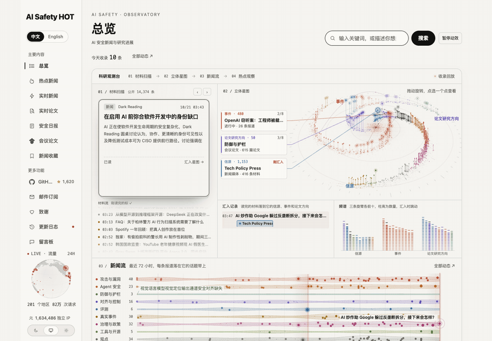

<p align="center"></p>

<h1 align="center">AI Safety HOT Hub</h1>

<p align="center"><b>追踪 AI 安全新闻、论文与事件。一站阅读，也能接入你的 Agent。</b></p>

<p align="center">
  <a href="https://aisafetyhot.com/zh"></a>
  <a href="docs/agent.md"></a>
  <a href="#skills"></a>
  <a href="https://github.com/wuyoscar/AISafetyHot-Hub/stargazers"></a>
</p>

<p align="center"><a href="README.md">简体中文</a> · <a href="README.en.md">English</a> · <a href="README.ja.md">日本語</a></p>

<p align="center"><a href="https://aisafetyhot.com/zh"></a></p>

<p align="center"><a href="https://aisafetyhot.com/zh">打开观测台</a> · <a href="https://aisafetyhot.com/zh/featured">实时新闻</a> · <a href="https://aisafetyhot.com/zh/papers">找论文</a> · <a href="https://aisafetyhot.com/zh/daily">读日报</a> · <a href="#agent">接入 Agent</a></p>

**AI Safety HOT** 持续整理越狱、提示注入、Agent 安全、防御与护栏、对齐、评测、真实事件和治理政策。网站提供中英文阅读；这个 Hub 保存公开论文清单、日报归档和 Agent 技能。

## 从一条动态，看到它关联的研究与事件

首页是一座可以探索的**科研观测台**：材料卡片逐条扫描，汇入由信源、事件和论文研究方向组成的立体星图；往下是最近 72 小时的新闻流，以及汇集报道与社区讨论的热点观察。拖动星图旋转，点选节点，沿链接继续阅读。

上面的 GIF 来自真实网站录屏。[查看高清静态图](assets/site-overview.webp) · [查看新闻流与热点观察](assets/site-news-flow.webp)

| 想看什么 | 从这里开始 |
| --- | --- |
| 最近发生了什么 | [实时新闻](https://aisafetyhot.com/zh/featured)：浏览动态、阅读导读，回到原文。 |
| 一件事怎样发展 | [热点新闻](https://aisafetyhot.com/zh/hot)：把相关报道放在一起，查看事件进展与讨论。 |
| 一个方向有哪些研究 | [实时论文](https://aisafetyhot.com/zh/papers)与[会议论文](https://aisafetyhot.com/zh/conferences)：按研究方向筛选，查看题录、速读和原文。 |
| 每天集中读一遍 | [安全日报](https://aisafetyhot.com/zh/daily)：按方向整理，当天的新进展补进同一期。 |

<details>
<summary><b>展开新版页面截图</b></summary>

### 实时新闻

按时间浏览新闻，结合搜索与筛选找到你关心的动态。

<a href="https://aisafetyhot.com/zh/featured"></a>

### 热点新闻

从一个事件进入，查看相关报道和讨论。

<a href="https://aisafetyhot.com/zh/hot"></a>

### 实时论文

按研究方向、论文类型和 Agent 场景筛选，继续阅读速读与原文。

<a href="https://aisafetyhot.com/zh/papers"></a>

### 会议论文

浏览 AI 与安全会议中的相关工作，按方向查找论文。

<a href="https://aisafetyhot.com/zh/conferences"></a>

### 安全日报

把当天值得关注的新闻和研究集中读完。

<a href="https://aisafetyhot.com/zh/daily"></a>

</details>

<a id="agent"></a>

## 让你的 Agent 一起读

连接 MCP，再安装技能，就可以直接用自然语言查动态、找研究线索、追踪实验室或事件。

**Claude Code** · 安装技能包与 MCP

```bash
/plugin marketplace add wuyoscar/AISafetyHot-Hub
/plugin install aisafetyhot@aisafetyhot-hub
```

**Codex**

```bash
npx skills add wuyoscar/AISafetyHot-Hub
codex mcp add aisafetyhot --url https://aisafetyhot.com/api/mcp
```

**Cursor / 其他 Agent** · 用 `npx skills add wuyoscar/AISafetyHot-Hub` 安装支持的技能，再在客户端添加 MCP 地址 `https://aisafetyhot.com/api/mcp`，选择 Streamable HTTP。

近期 News 简报无需 API Key。历史查询与完整论文解读等需要只读授权，具体范围和接入方法见 [Agent 指南](docs/agent.md)；网站可直接阅读。

<a id="skills"></a>
<a id="技能"></a>

### 六个技能，按需要使用

| 技能 | 用途 | 可以这样问 |
| --- | --- | --- |
| [`aisafety-brief`](skills/aisafety-brief/SKILL.md) | 近期安全简报 | 这周 AI 安全有什么大事？ |
| [`aisafety-paper-scout`](skills/aisafety-paper-scout/SKILL.md) | 查找论文与引用线索 | 找 Agent 提示注入相关论文。 |
| [`aisafety-related-work`](skills/aisafety-related-work/SKILL.md) | 从研究问题整理相关工作 | 根据这份摘要，整理 reward hacking 的相关工作。 |
| [`aisafety-lab-watch`](skills/aisafety-lab-watch/SKILL.md) | 追踪一家实验室 | Anthropic 最近一周有哪些安全进展？ |
| [`aisafety-incident-check`](skills/aisafety-incident-check/SKILL.md) | 查找事件与漏洞报道 | Cursor 最近有哪些安全事件？ |
| [`aisafetyhot`](skills/aisafetyhot/SKILL.md) | MCP 工具与查询说明 | 查看工具、筛选和分页用法。 |

[查看调用示例](docs/mcp-examples.md)

## 每日论文与公开归档

[每日论文](daily-papers)从论文库中每天挑选 30 篇，跨日去重，兼顾近期研究与较早的重要工作；保留原始发表日期、原文和站内阅读链接。也可以按[研究方向](daily-papers/topics)浏览。

| 归档 | 内容 |
| --- | --- |
| [daily-papers](daily-papers) | 每日论文推荐与方向索引 |
| [daily](daily) · [English](en) | 已公开的日报归档 |
| [papers](papers) | 按日期导出的论文 Markdown、JSON 与 BibTeX |
| [archive](archive) | 年度索引 |

<!-- papers:start -->
### 2026-10-22 · 30 篇

1. **[Contextual Candour: Role-Aware Graduated Disclosure for LLMs over Mixed-Sensitivity Contexts](https://arxiv.org/abs/2610.28067)**  
   研究者提出“分级披露”（graduated disclosure），把 LLM 访问控制从“全答或拒答”改为按用户授权校准回答的细节与敏感度。 · Devansh Srivastav … Lea Schönherr · arXiv 2610.28067 · 2026-10-20 · [解读](https://aisafetyhot.com/items/ssbn8rs0cfh4e6xb9k4dsd5np)
2. **[S-Agent 2.0: Spatial Reasoning with a General Coding Agent](https://huggingface.co/papers/2610.28354)**  
   用通用编程智能体加感知工具闭合空间推理证据环 · Rui Gong … Ziwei Liu · arXiv 2610.28354 · 2026-10-20 · [解读](https://aisafetyhot.com/items/rye0f15mz7f3gjykjbqbthg3n)
3. **[MAS-Guard: Unified Guardrails from Individual Agents to Multi-Agent LLM Systems](https://arxiv.org/abs/2610.28397)**  
   提出 MAS-Guard，在单智能体与多智能体边界统一拦截不安全动作与对抗操纵 · `Agent 安全` · Mohammad Kachuee … Dan Roth · arXiv 2610.28397 · 2026-10-20 · [解读](https://aisafetyhot.com/items/jmbovkl9cqzg7j0e7gmshtmr2)
4. **[Adversarial Benchmarks and BenchDoor Attacks: Exploiting Benchmark Incentives for Backdoor Attacks](https://arxiv.org/abs/2610.27533)**  
   提出 BenchDoor，用脏标签投毒使被采纳数据既抬高基准分又植入后门 · `后门与投毒` · Yixin Wu … Tadayoshi Kohno · arXiv 2610.27533 · 2026-10-20 · [解读](https://aisafetyhot.com/items/ipnmbz6zrzwn0ytajr7zgxusj)
5. **[Can Native Safety Travel? Reusing Safety Pretraining Across Models via On-Policy Distillation](https://arxiv.org/abs/2610.27555)**  
   论文提出原生安全复用问题，并展示安全预训练模型的安全鲁棒性可通过 on-policy 蒸馏迁移到标准预训练学生模型。 · Bingqi Shang … Sijia Liu · arXiv 2610.27555 · 2026-10-20 · [解读](https://aisafetyhot.com/items/cvs0dbflthq4rgdm5m2h0ksb6)
6. **[The Show-Up Attack: When Subagents Win Over Their Supervisor](https://arxiv.org/abs/2610.27574)**  
   提出 Show-up 攻击，诱导 supervisor 让恶意子智能体参与越界任务 · Maosen Zhang … Han Qiu · arXiv 2610.27574 · 2026-10-20 · [解读](https://aisafetyhot.com/items/pyttnv6q2qxqvrwgmj4uyn6z1)
7. **[Why Static Probes Fail: Context Determines Deception Feature Composition](https://arxiv.org/abs/2610.27577)**  
   论文指出，把欺骗视为表征空间中单一方向的线性探针无法在不同欺骗场景间泛化，并提出将欺骗表示为多维子空间。 · Yao Huang … Yinpeng Dong · arXiv 2610.27577 · 2026-10-20 · [解读](https://aisafetyhot.com/items/welmi27v33kv5dqst7qxoo5ca)
8. **[Reward Misspecification Degrades Chain-of-Thought Monitorability](https://arxiv.org/abs/2610.28303)**  
   分析奖励错配如何降低 CoT 可监控性并提出奖励描述训练 · `奖励作弊` · Tianyi Lorena Yan, John Hewitt · arXiv 2610.28303 · 2026-10-20 · [解读](https://aisafetyhot.com/items/i0me4pp5aw6uypiepunx79gec)
9. **[You Are the Trigger: Speaker-Activated Backdoors](https://arxiv.org/abs/2610.27210)**  
   用 SAB 将目标说话人的自然语音设为后门触发器 · `后门与投毒` · Nataša Krčo … Yves-Alexandre de Montjoye · arXiv 2610.27210 · 2026-10-19 · [解读](https://aisafetyhot.com/items/wejc7tsr3dljp5gsvrv4lv4ju)
10. **[AutoRedClaw: Automated Red-Teaming for Claw-Style Agents](https://arxiv.org/abs/2610.27244)**  
   提出 AutoRedClaw，经环境内容投毒 Claw 智能体并跨会话触发 · Hao Li … Chaowei Xiao · arXiv 2610.27244 · 2026-10-19 · [解读](https://aisafetyhot.com/items/eyu3ugyffr0g2obio0ecokacd)
11. **[On the Fragility of Tasks under Composition: Implicit Budgeting in Language Models](https://huggingface.co/papers/2610.27190)**  
   分析任务拼接导致的准确率下降与隐式思考预算 · Chenpan Li … Nikolaos Karalias · arXiv 2610.27190 · 2026-10-19 · [解读](https://aisafetyhot.com/items/jbmvcas3581etfl3fyrai8rfr)
12. **[Guided Diffusion for Trustworthy Synthetic Text Generation](https://arxiv.org/abs/2610.27259)**  
   提出 Guided Diffusion，在差分隐私下引导生成合成文本 · Qi Pang … G. Edward Suh · arXiv 2610.27259 · 2026-10-19 · [解读](https://aisafetyhot.com/items/fcfbirjcezg8z6ahgmdd61elo)
13. **[On the Limits of Scale: Inverse Scaling in Vision-Language Models](https://huggingface.co/papers/2610.27360)**  
   用逐题翻转分析测量同家族视觉语言模型的反向缩放 · Rohit Saxena … Pasquale Minervini · arXiv 2610.27360 · 2026-10-19 · [解读](https://aisafetyhot.com/items/o7hofytdpy66mxngd5y7x9hm1)
14. **[Fundamental Impossibility Results in AI Safety: Trading Off between Desiderata](https://arxiv.org/abs/2610.27373)**  
   证明公开建议无法同时最大化帮助防守方并隐藏 minimax · Ida Mattsson … Vincent Conitzer · arXiv 2610.27373 · 2026-10-19 · [解读](https://aisafetyhot.com/items/yafdytphxgprfv4kfy25l44o2)
15. **[StopLoss: Teaching Agents to Predict Failure and Stop Early](https://huggingface.co/papers/2610.25525)**  
   提出 StopLoss，用小模型预测编码智能体失败并提前停止 · Jiarong Liang … Wenhu Chen · arXiv 2610.25525 · 2026-10-18 · [解读](https://aisafetyhot.com/items/tzgirarzuwn15kv8abj866xc5)
16. **[VA-Judger: Reward Modeling from Human Preference Feedback for Joint Video-Audio Generation](https://arxiv.org/abs/2608.18607v4)**  
   提出 VA-Judger，用人类偏好训练联合音视频奖励模型 · Yinming Huang … Zuxuan Wu · arXiv 2608.18607 · 2026-08-19 · [解读](https://aisafetyhot.com/items/np6jtiwlwpgbbacgry9dttrga)
17. **[Understanding Cognition-Induced Risks in Agentic AI Systems](https://arxiv.org/abs/2608.15304)**  
   提出三层认知框架，归纳智能体扩大认知范围带来的人本风险与缓解策略 · Guanchu Wang … Bowen Zhou · arXiv 2608.15304 · 2026-08-15 · [解读](https://aisafetyhot.com/items/yq9ekzxeqonksu2r0rdq3g8wd)
18. **[AI and Consumer Rights in India Working Paper](https://arxiv.org/abs/2608.12863)**  
   对照印度消费者保护法分析 AI 产品伤害的归责缺口 · Omir Kumar … Balaraman Ravindran · arXiv 2608.12863 · 2026-08-13 · [解读](https://aisafetyhot.com/items/duwx34j581uqt8zjkb0vj0a90)
19. **[Monitoring Monitorability](https://openreview.net/forum?id=b82fgbMVpz)**  
   提出三类评估原型与可监控性指标，发现CoT监控优于仅动作监控，更长思维链通常更可监控，追问并共享思维链可提升可监控性。 · `监控与 AI 控制` · Melody Y. Guan … Bowen Baker · ICML 2026 spotlight
20. **[Training a General Purpose Automated Red Teaming Model](https://arxiv.org/abs/2604.23067)**  
   提出强化学习流程，训练能按任意对抗目标生成攻击的红队模型 · `越狱与攻击` · Aishwarya Padmakumar … Christopher Parisien · arXiv 2604.23067 · 2026-04-24 · [解读](https://aisafetyhot.com/items/xv2fxmfpsehzuvne1wjk8gnco)
21. **[On the Existence of Consistent Adversarial Attacks in High-Dimensional Linear Classification](https://openreview.net/forum?id=PUIivg3GrO)**  
   提出区分对抗攻击与表达能力不足所致误分类的新误差度量，给出高维二分类的精确渐近刻画，发现模型越过参数化，对保持标签的扰动越脆弱。 · `越狱与攻击` · Matteo Vilucchio … Bruno Loureiro · ICML 2026 spotlight
22. **[Exact Unlearning in Reinforcement Learning](https://openreview.net/forum?id=oLmwqIhzqj)**  
   形式化强化学习中的精确遗忘问题，提出TV稳定的RL算法，使删除用户数据后的输出与从未交互不可区分，计算成本仅为重训的一小部分，并证明其接近极小极大最优。 · `隐私与数据泄露` · Thanh Nguyen-Tang, Raman Arora · ICML 2026 spotlight
23. **[Copyright-Bench: Agentic Evaluation of Copyright Law Compliance](https://openreview.net/forum?id=7y6a5ouziq)**  
   构建评估 LLM 智能体版权法合规性的基准，发现智能体在有公共领域替代品时仍选用侵权内容，开源权重模型在用户偏好和时间压力下违规率上升。 · `Agent 安全` · Zheng Hui … Noam Kolt · ICML 2026 spotlight
24. **[No Attacker Needed: Unintentional Cross-User Contamination in Shared-State LLM Agents](https://arxiv.org/abs/2604.01350)**  
   形式化并评测共享状态 Agent 的无意跨用户污染 · Tiankai Yang … Yue Zhao · arXiv 2604.01350 · 2026-04-01 · [解读](https://aisafetyhot.com/items/jn0wzoy9etpeomq5x13oqzj6n)
25. **[Every Language Model Has a Forgery-Resistant Signature](https://openreview.net/forum?id=vLFqOoMBol)**  
   发现语言模型输出位于高维椭圆面上，构成难以伪造的天然模型签名，可用于识别输出来源并提出类似对称密钥认证的输出验证协议。 · `开源模型与权重安全` · Matthew Finlayson … Swabha Swayamdipta · ICLR 2026 Oral
26. **[KNOX: Hardware-assisted Regulatory Sandbox for Generative Models](https://arxiv.org/abs/2610.27543)**  
   提出监管沙箱 KNOX，在 TEE 内拦截未授权工具与系统调用 · `Agent 安全` · Vasisht Duddu … Xi He · arXiv 2610.27543 · 2026-10-20 · [解读](https://aisafetyhot.com/items/ktzhekpslnbmrcb295rc74llg)
27. **[Push-Pull Attentional Anchoring for Diffusion Concept Erasure](https://arxiv.org/abs/2610.27719)**  
   提出 PPAA，在交叉注意力上推拉擦除扩散模型的指定概念 · `防御与护栏` · Nattanat Chatthee … Supasorn Suwajanakorn · arXiv 2610.27719 · 2026-10-20 · [解读](https://aisafetyhot.com/items/lm181gm465y19ab8oin2itauk)
28. **[Evolving Agent Interfaces](https://huggingface.co/papers/2610.28601)**  
   提出 Agent S4，在固定模型下演化计算机使用智能体的接口仓库 · Saaket Agashe … Xin Eric Wang · arXiv 2610.28601 · 2026-10-20 · [解读](https://aisafetyhot.com/items/u29sgodb8oimksf6rp3lnfpqk)
29. **[Humans Correct Their Judgments Through Debate, but Weaker AI Models Do Not](https://arxiv.org/abs/2610.28539)**  
   比较辩论与咨询协议，测量人类和较弱模型能否修正科学判断 · Maria Victoria Carro … Maria Vanina Martinez · arXiv 2610.28539 · 2026-10-20 · [解读](https://aisafetyhot.com/items/zosrefh77727n9al0jfrsnuf1)
30. **[Speak vs. Know: Balancing Behavior and Knowledge Distributions of Large Language Models](https://arxiv.org/abs/2610.27648)**  
   提出平衡分布，用凸组合对齐行为众数与口头知识形状 · Yang Liu … Chenhui Chu · arXiv 2610.27648 · 2026-10-20 · [解读](https://aisafetyhot.com/items/ghi1tddjm77gj196y22tvmf0r)

[往期每日论文](daily-papers/2026) · [论文库](https://aisafetyhot.com/zh/papers)

**按方向**：[防御与护栏](daily-papers/topics/defense.md) 21 · [Agent 安全](daily-papers/topics/agent-security.md) 14 · [后门与投毒](daily-papers/topics/backdoor.md) 9 · [隐私与数据泄露](daily-papers/topics/privacy.md) 6 · [越狱与攻击](daily-papers/topics/jailbreak.md) 6 · [奖励作弊](daily-papers/topics/reward-hacking.md) 5 · [对齐](daily-papers/topics/alignment.md) 4 · [监控与 AI 控制](daily-papers/topics/ai-control.md) 3 · [欺骗与谋划](daily-papers/topics/scheming.md) 3 · [红队测试与挑战赛](daily-papers/topics/red-teaming.md) 2 · [开源模型与权重安全](daily-papers/topics/open-models.md) 1 · [可解释性](daily-papers/topics/interpretability.md) 1
<!-- papers:end -->

## 反馈与支持

内容摘要和解读由 AI 辅助整理，关键结论请结合原文阅读。发现错误或想推荐材料，欢迎到[留言板](https://aisafetyhot.com/zh/board)交流。

觉得有用，欢迎 **Star**，方便下次回来；也可以[请作者喝杯咖啡](https://buymeacoffee.com/wuyoscar)。


