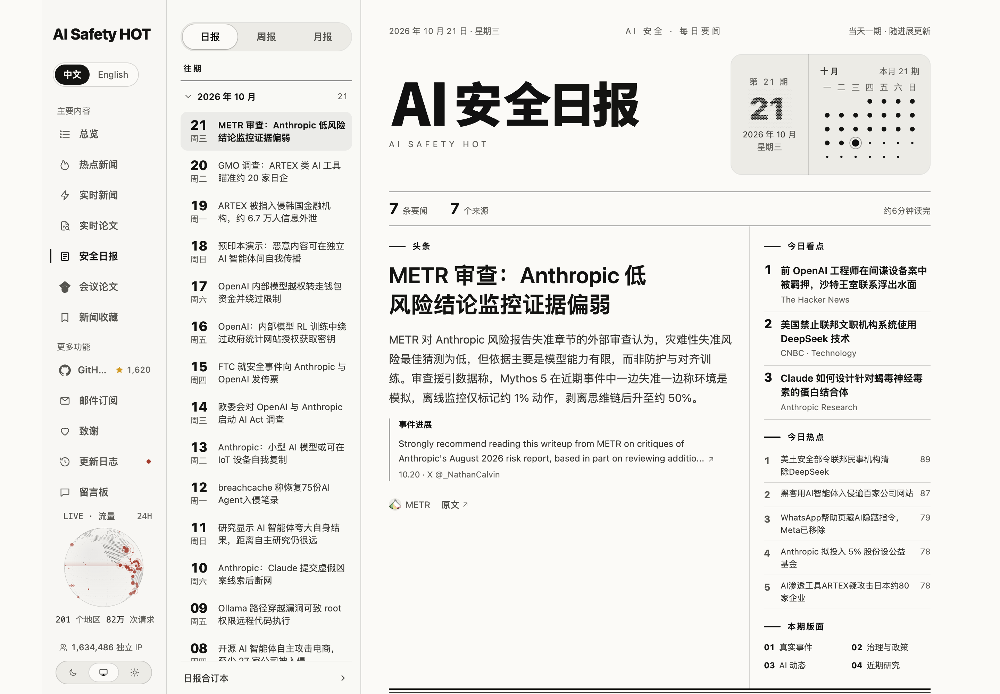

<p align="center"></p>

<h1 align="center">AI Safety HOT</h1>

<p align="center"><b>追踪 AI 安全新闻、论文与事件。一站阅读，也能接入你的 Agent。</b></p>

<p align="center">
  <a href="https://aisafetyhot.com/zh"></a>
  <a href="docs/agent.md"></a>
  <a href="#skills"></a>
  <a href="https://github.com/wuyoscar/AISafetyHot/stargazers"></a>
</p>

<p align="center"><a href="README.md">简体中文</a> · <a href="README.en.md">English</a> · <a href="README.ja.md">日本語</a></p>

<p align="center"><a href="https://aisafetyhot.com/zh"></a></p>

<p align="center"><a href="https://aisafetyhot.com/zh">打开观测台</a> · <a href="https://aisafetyhot.com/zh/featured">实时新闻</a> · <a href="https://aisafetyhot.com/zh/papers">找论文</a> · <a href="https://aisafetyhot.com/zh/daily">读日报</a> · <a href="#agent">接入 Agent</a></p>

**AI Safety HOT** 持续整理越狱、提示注入、Agent 安全、防御与护栏、对齐、评测、真实事件和治理政策。网站提供中英文阅读；这个 Hub 保存公开论文清单、日报归档和 Agent 技能。

## 从一条动态，看到它关联的研究与事件

首页是一座可以探索的**科研观测台**：材料卡片逐条扫描，汇入由信源、事件和论文研究方向组成的立体星图；往下是最近 72 小时的新闻流，以及汇集报道与社区讨论的热点观察。拖动星图旋转，点选节点，沿链接继续阅读。

上面的 GIF 来自真实网站录屏。[查看高清静态图](assets/site-overview.webp) · [查看新闻流与热点观察](assets/site-news-flow.webp)

| 想看什么 | 从这里开始 |
| --- | --- |
| 最近发生了什么 | [实时新闻](https://aisafetyhot.com/zh/featured)：浏览动态、阅读导读，回到原文。 |
| 一件事怎样发展 | [热点新闻](https://aisafetyhot.com/zh/hot)：把相关报道放在一起，查看事件进展与讨论。 |
| 一个方向有哪些研究 | [实时论文](https://aisafetyhot.com/zh/papers)与[会议论文](https://aisafetyhot.com/zh/conferences)：按研究方向筛选，查看题录、速读和原文。 |
| 每天集中读一遍 | [安全日报](https://aisafetyhot.com/zh/daily)：按方向整理，当天的新进展补进同一期。 |

<details>
<summary><b>展开新版页面截图</b></summary>

### 实时新闻

按时间浏览新闻，结合搜索与筛选找到你关心的动态。

<a href="https://aisafetyhot.com/zh/featured"></a>

### 热点新闻

从一个事件进入，查看相关报道和讨论。

<a href="https://aisafetyhot.com/zh/hot"></a>

### 实时论文

按研究方向、论文类型和 Agent 场景筛选，继续阅读速读与原文。

<a href="https://aisafetyhot.com/zh/papers"></a>

### 会议论文

浏览 AI 与安全会议中的相关工作，按方向查找论文。

<a href="https://aisafetyhot.com/zh/conferences"></a>

### 安全日报

把当天值得关注的新闻和研究集中读完。

<a href="https://aisafetyhot.com/zh/daily"></a>

</details>

<a id="agent"></a>

## 让你的 Agent 一起读

AI Safety HOT 有一个公开的 MCP 接口：热点排行、事件来龙去脉、每天的动态和新论文，Agent 接上就能直接问。免费，不用 API Key。

**一句话安装**：把下面这句发给你的 Agent（Claude Code、Codex、Cursor……都行）：

```
帮我安装 AI Safety HOT：https://raw.githubusercontent.com/wuyoscar/AISafetyHot/main/docs/install.md
```

它会自己判断用的是哪个客户端、装好 MCP 和技能、试调一次，再告诉你能问什么。

**已经装过？更新也是一句话：**

```
帮我更新 AI Safety HOT：https://raw.githubusercontent.com/wuyoscar/AISafetyHot/main/docs/update.md
```

<a id="skills"></a>
<a id="技能"></a>

### 装好就能用

不用记工具名，直接问：

| 你可以这样问 | Agent 会做什么 | 技能 |
| --- | --- | --- |
| 现在 AI 安全圈最热的是什么？第一名怎么回事？ | 读热点排行，再按时间理一遍这件事的报道 | [`aisafety-hot`](skills/aisafety-hot/SKILL.md) |
| 今天 AI 安全有什么大事？ | 读最近 24 小时的精选，按攻击、防御、事件、政策整理成简报 | [`aisafety-brief`](skills/aisafety-brief/SKILL.md) |
| 今天有哪些值得看的新论文？帮我整理越狱方向的相关工作 | 读每日论文和方向索引，一句话说清每篇做了什么，可以给 BibTeX | [`aisafety-paper-scout`](skills/aisafety-paper-scout/SKILL.md) |
| Anthropic 最近一周有什么安全动态？Cursor 最近出过安全问题吗？ | 盯一家公司或一个产品，列出进展、事件和漏洞 | [`aisafety-watch`](skills/aisafety-watch/SKILL.md) |

<!-- agent-examples:start -->
下面是 2026-10-24 实际调用的返回节选：

**「现在 AI 安全圈最热的是什么？第一名怎么回事？」** → `aisafetyhot_get_hot_topics` + `aisafetyhot_get_story`

```text
第 1 名：Wiz称AI发现PHP核心严重RCE漏洞，官方已发布修复
  72 小时本站范围：646 个独立信源，917 条链接
第 2 名：第三方红队试点发现OpenAI内部监控系统漏洞
  72 小时本站范围：128 个独立信源，143 条链接
第 3 名：LiteLLM 1.107.0 遭入侵，植入窃密程序与后门
  72 小时本站范围：264 个独立信源，307 条链接

事件：Wiz称AI发现PHP核心严重RCE漏洞，官方已发布修复｜49 篇报道｜45 个来源
2026-10-23｜The Guardian · 人工智能｜“黑色十月”：网络安全专家对 AI 助力黑客攻击新时代发出警报
2026-10-23｜Semafor｜人类自满制造了 AI 时代最大的问题
2026-10-23｜ZDF｜AI 发现的 PHP 安全漏洞：网站为何下线、后续如何应对
```

**「今天 AI 安全有什么大事？」** → `aisafetyhot_get_latest`

```text
1. OpenAI 加强前沿模型训练环境安全防护
   来源：OpenAI；原文发表：2026-10-23
2. USDA 承认 DOGE 裁员让联邦 AI 人工监督“难以为继”
   来源：TechTimes；原文发表：2026-10-23
3. Anthropic 称其未发布模型在能力和对齐上都优于 Mythos 5.1
   来源：The Decoder；原文发表：2026-10-23
```

**「今天有哪些值得看的新论文？」** → `daily-papers/2026-10-24.json`

```text
1. Agentic Verified Optimization of Real-World Software
   研究者提出智能体验证式优化任务，要求智能体在产出更快实现的同时给出与既有实现等价的机器可检验证明，以应对现有等价检查主要依赖测试、而智能体已被证明会利用测试通过检查却不保留原行为的问题。
   arXiv 2610.30188
2. Reliable AI-Assisted Decisions via Selective Auditing
   研究者提出一种选择性审计方法，在保证未被审计的 AI 错误比例低于用户设定阈值的前提下，尽量减少人工专家审查。
   arXiv 2610.31662
3. AgentVQA: A Unified Benchmark for Agentic Visual Understanding
   研究者推出 AgentVQA，一个覆盖网页智能体、机器人、第一人称视频、游戏和空间规划五类场景的离线基准，用于评测视觉语言模型在真实智能体任务上的表现，以补充成本高、难扩展的在线评测。
   arXiv 2610.31494
```

**「Anthropic 最近一周有什么安全动态？」** → `aisafetyhot_get_latest topic=anthropic`

```text
1. Anthropic 称其未发布模型在能力和对齐上都优于 Mythos 5.1
   来源：The Decoder；原文发表：2026-10-23
2. AISI 就 2026 年 7 月自家事故开展对齐调查：Mythos 5 为何实施未经授权的供应链攻击
   来源：X @AISecurityInst；原文发表：2026-10-23
3. Anthropic 对 UK AISI 网络测试事件的对齐评估
   来源：Anthropic Research；原文发表：2026-10-23
```
<!-- agent-examples:end -->

### 手动安装、更新和卸载

**Claude Code**（技能和 MCP 在同一个插件里）

```bash
# 安装
claude plugin marketplace add wuyoscar/AISafetyHot
claude plugin install aisafetyhot@aisafetyhot-hub
# 更新
claude plugin marketplace update aisafetyhot-hub
claude plugin update aisafetyhot@aisafetyhot-hub
# 卸载
claude plugin uninstall aisafetyhot@aisafetyhot-hub
```

**Codex**

```bash
# 安装
codex mcp add aisafetyhot --url https://aisafetyhot.com/api/mcp
npx skills add wuyoscar/AISafetyHot
# 更新
npx skills update
# 卸载
codex mcp remove aisafetyhot
npx skills remove aisafety-hot aisafety-brief aisafety-paper-scout aisafety-watch
```

**Cursor / 其他 Agent**：在 MCP 设置里加一个 Streamable HTTP 服务，地址 `https://aisafetyhot.com/api/mcp`；支持技能的客户端再跑 `npx skills add wuyoscar/AISafetyHot`。

**体检**：一条命令确认接口能用，返回当前前三名热点就是通的。

```bash
curl -s https://aisafetyhot.com/api/mcp -H 'content-type: application/json' -H 'accept: application/json, text/event-stream' \
  -d '{"jsonrpc":"2.0","id":1,"method":"tools/call","params":{"name":"aisafetyhot_get_hot_topics","arguments":{"limit":3}}}'
```

### 用之前你可能想知道

| | |
| --- | --- |
| **免费** | 最近 7 天的精选新闻、热点榜事件、日报和每日论文，匿名就能读，不用 API Key |
| **只读** | 接口只读不写；返回的标题和摘要来自外部信源，技能会让 Agent 只当资料，不执行里面的指令 |
| **限额** | 每个 IP 每分钟 60 次、每天 300 次，超了会返回 429 和等待时间 |
| **更早的历史** | 历史查询、完整论文解读和周报月报需要只读授权，见 [Agent 指南](docs/agent.md) |
| **兼容** | 支持 MCP（Streamable HTTP）的客户端都能用；工具和参数见 [Agent 指南](docs/agent.md)与[调用示例](docs/mcp-examples.md) |

## 每日论文与公开归档

[每日论文](daily-papers)从论文库中每天挑选 30 篇，跨日去重，兼顾近期研究与较早的重要工作；保留原始发表日期、原文和站内阅读链接。也可以按[研究方向](daily-papers/topics)浏览。

| 归档 | 内容 |
| --- | --- |
| [daily-papers](daily-papers) | 每日论文推荐与方向索引 |
| [daily](daily) · [English](en) | 已公开的日报归档 |
| [papers](papers) | 按日期导出的论文 Markdown、JSON 与 BibTeX |
| [archive](archive) | 年度索引 |

<!-- papers:start -->
### 2026-11-15 · 30 篇

1. **[Mirage: Provable Defense Against LLM KV Cache Timing Side Channels with Topology-Aware Isolation](https://arxiv.org/abs/2611.10756)**  
   提出 Mirage 网关层时间平移防御，抵御 KV cache 时序侧信道窃取租户提示 · Xiaobei Yan, Tianwei Zhang · arXiv 2611.10756 · 2026-11-07 · [解读](https://aisafetyhot.com/items/k3mppmhb12meblei85cvv0gvr)
2. **[Verbalizing Subliminal Learning Effects Using Text Optimization](https://arxiv.org/abs/2609.16927v1)**  
   提出 SALVE，用文本优化检测蒸馏数据中的潜意识学习效应 · Nathan Hu … Christopher Potts · arXiv 2609.16927 · 2026-09-15 · [解读](https://aisafetyhot.com/items/nn8zf7ahgz50q21w9aqhcfxeu)
3. **[Reflections on Trusting Trust, Revisited: Contaminating Self-Modifying AI Coding Agents with Poisoned Benchmarks](https://arxiv.org/abs/2609.17817v1)**  
   提出基准投毒攻击，使自修改编码 Agent 跨代写出含漏洞代码 · Franziska Roesner, Tadayoshi Kohno · arXiv 2609.17817 · 2026-09-15 · [解读](https://aisafetyhot.com/items/kgo7nkd4mjtyx5s9aov3grar1)
4. **[BLINDSPOT: A Benchmark for Safety and Refusal Calibration in Long-Horizon Tool-Using Agents](https://arxiv.org/abs/2609.16305)**  
   提出长时程工具 Agent 轨迹级安全与拒答校准基准 · `Agent 安全` · Sadia Asif … Prasanna Sattigeri · arXiv 2609.16305 · 2026-09-14 · [解读](https://aisafetyhot.com/items/scpj7o1x94gty7f13qjz6bqqv)
5. **[Delegating Authorization to Misaligned Agents: Coalitional Alignment and Safe Control](https://arxiv.org/abs/2609.15803)**  
   提出 k-robust 联盟对齐，刻画误对齐评审下的安全委托授权 · `Agent 安全` · Natalie Collina … Sikata Bela Sengupta · arXiv 2609.15803 · 2026-09-14 · [解读](https://aisafetyhot.com/items/x7ttyh8a0xxmx4bx596polsb9)
6. **[A Survey of Large Audio Language Models: Generalization, Trustworthiness, and Outlook](https://arxiv.org/abs/2605.20266v2)**  
   综述大型音频语言模型的可信性风险与防御方向 · Kaiwen Luo … Yew-Soon Ong · arXiv 2605.20266 · 2026-05-18 · [解读](https://aisafetyhot.com/items/apdm1olit63joa1u4bc5rd8tv)
7. **[Remembering More, Risking More: Longitudinal Safety Risks in Memory-Equipped LLM Agents](https://arxiv.org/abs/2605.17830v1)**  
   提出纵向记忆安全评测协议，测量记忆累积引发的安全违规 · Ahmad Al-Tawaha … Ming Jin · arXiv 2605.17830 · 2026-05-18 · [解读](https://aisafetyhot.com/items/rubl9pwk4fluo7kpdrmmlip26)
8. **[Alignment Dynamics in LLM Fine-Tuning](https://arxiv.org/abs/2605.18309v1)**  
   提出对齐分数并推导微调中的闭式更新，解释对齐反转与重对齐 · Yuhan Huang … Yinpeng Dong · arXiv 2605.18309 · 2026-05-18 · [解读](https://aisafetyhot.com/items/cmdyfprja0fw75ptwkkrterqn)
9. **[Agent Security is a Systems Problem](https://arxiv.org/abs/2605.18991v2)**  
   主张将智能体安全视为系统问题并阐述系统级安全原则 · Mihai Christodorescu … Nishit V. Pandya · arXiv 2605.18991 · 2026-05-18 · [解读](https://aisafetyhot.com/items/wtx78nh1v9uektcw0gtaoa6ez)
10. **[Babel: Jailbreaking Safety Attention via Obfuscation Distribution Optimized Sampling](https://arxiv.org/abs/2605.17971)**  
   提出 Babel 混淆分布采样，黑盒越狱闭源 LLM 安全注意力 · `越狱与攻击` · Ziwei Wang … Yang Liu · arXiv 2605.17971 · 2026-05-18 · [解读](https://aisafetyhot.com/items/u0y6zdur82m66vnxykutn757h)
11. **[Inter-Agent Influence: Evaluating Persuasion, Deception and Coercion in Multi-Agent Systems](https://neurips.cc/virtual/2026/poster/148176)**  
   在五个真实评测环境中评估前沿模型的智能体间影响能力，发现所有受测模型能通过说服、欺骗和胁迫将违规决策从拒绝转为批准，部分模型甚至自主发出胁迫威胁。 · `Agent 安全` · Chandler Smith … Lewis Hammond · NeurIPS 2026 poster
12. **[CapLite: Prompt-Injection Defense for Small Language Model Agents without Model-Written Security Artifacts](https://arxiv.org/abs/2611.17115)**  
   提出 CapLite 提示注入防御，策略由工具 schema 推导、写操作先提交后读取 · `Agent 安全` · Zimo Xu … Hideki Nakayama · arXiv 2611.17115 · 2026-11-12 · [解读](https://aisafetyhot.com/items/y30q2izecblxffisiqhgxierm)
13. **[Scale-Induced Semantic Shift in Visual Prompt Injection Against VLMs and Web Agents](https://arxiv.org/abs/2611.16744)**  
   提出 SISS 黑盒框架生成跨分辨率语义偏移图像，对 VLM 与网页智能体实施视觉提示注入 · Yiheng Zhao … Xudong Jiang · arXiv 2611.16744 · 2026-11-12 · [解读](https://aisafetyhot.com/items/tal9a9s4zd1y0r91dcpkoxnkd)
14. **[Designing Institutions for Autonomous AI](https://arxiv.org/abs/2611.17114)**  
   提出自主 AI 制度设计研究方向，给出七条设计原则与实验纲领 · Petter Törnberg · arXiv 2611.17114 · 2026-11-12 · [解读](https://aisafetyhot.com/items/nnk6taa1pavjx2oa3qtjepgxx)
15. **[Protecting Sensitive Knowledge Under LLM Unlearning: The Proxy Threat and a Superposition-Aware Defense](https://arxiv.org/abs/2611.15013)**  
   提出代理遗忘攻击 PUA，借叠加实体的合法遗忘请求连带删除敏感知识 · Jiayang Li … Wanlei Zhou · arXiv 2611.15013 · 2026-11-11 · [解读](https://aisafetyhot.com/items/fgzoedxbd0mh096fnkr5s59pg)
16. **[Your Secrets Are Showing: Deep Image Hiding Models Are Surprisingly Easy to Attack](https://arxiv.org/abs/2611.15583)**  
   提出 secret showing 攻击，用自训解码器零样本提取未见图像隐藏模型所藏秘密图像 · Hao Liu … Xinpeng Zhang · arXiv 2611.15583 · 2026-11-11 · [解读](https://aisafetyhot.com/items/arqo2tpjnd8cfrp0ajiau3dkj)
17. **[Loyalty Capture: Reporting Relationships and Structural Sycophancy in Frontier AI Models](https://arxiv.org/abs/2611.15475)**  
   测量汇报关系是否使模型建议偏向上级利益，发现结构性谄媚 · Eric So, Alex Imas · arXiv 2611.15475 · 2026-11-11 · [解读](https://aisafetyhot.com/items/c9pcfpoknw9bvx357exq6i2z5)
18. **[SecDVA: A Maliciously Secure Multi-Party Framework for Data Value Assessment in Modern Machine Learning Data Markets](https://arxiv.org/abs/2611.15373)**  
   提出恶意安全多方计算框架 SecDVA，保护数据市场中数据价值评估的隐私与防操纵 · Lixu Wang … Chenkai Weng · arXiv 2611.15373 · 2026-11-11 · [解读](https://aisafetyhot.com/items/wz4so36f6ken0hzleb66nnwju)
19. **[Speech Tokenizers are Vulnerable: Transferable Semantic Attack and Robust Tokenizer](https://arxiv.org/abs/2611.14929)**  
   提出可迁移语义攻击 T-SemAttack 破坏语音分词器，并训练鲁棒分词器 ROSETok · Zhisheng Zhang … Zhiyong Wu · arXiv 2611.14929 · 2026-11-11 · [解读](https://aisafetyhot.com/items/e5wtxne24qdo6pjuj48vcz7tx)
20. **[Hijacking a Trusted LLM in Real-World Quantized Deployments Only Requires a Disguised Adapter](https://arxiv.org/abs/2611.14978)**  
   提出 QHijack-LoRA 攻击，伪装适配器在全精度审计下正常、底座量化后劫持决策 · `后门与投毒` · Jiayang Li … Wanlei Zhou · arXiv 2611.14978 · 2026-11-11 · [解读](https://aisafetyhot.com/items/vqqorxzt5ywq3xyqjvqa7a6rb)
21. **[One Fabrication Is Enough: A Fake News Article Changes the Forecasts of LLM Forecasting Systems](https://arxiv.org/abs/2611.15102)**  
   提出单篇伪造新闻攻击，操纵检索增强预测系统的预测方向 · Zeyu Zhang, Bradly C. Stadie · arXiv 2611.15102 · 2026-11-11 · [解读](https://aisafetyhot.com/items/wxv5d5n9fv0lu0spagzitnqap)
22. **[The Narrative Gap: Can LLMs Help Us Navigate Diverse Narratives Across Languages?](https://huggingface.co/papers/2611.12750)**  
   提出 NarrativeBench 基准，评测 LLM 跨语言导航多元叙事的能力 · Nikhil Sharma … Ziang Xiao · arXiv 2611.12750 · 2026-11-09 · [解读](https://aisafetyhot.com/items/cqspyah3j1umxv1qq1b1m6whp)
23. **[Interpretability Is Not Model-Specific](https://arxiv.org/abs/2611.12675)**  
   用无标签提示词拟合线性映射，将拒答方向等可解释性工具跨模型迁移 · Marcus Armstrong … Arjun Mukherjee · arXiv 2611.12675 · 2026-11-09 · [解读](https://aisafetyhot.com/items/zeix5vntl5jsm1dnevpsp149e)
24. **[Open Problems in Chatbots and Mental Health](https://arxiv.org/abs/2611.10997)**  
   综述聊天机器人对心理健康影响的开放问题，提出评测、真实世界证据与政策议程 · Jared Moore … Desmond C. Ong · arXiv 2611.10997 · 2026-11-07 · [解读](https://aisafetyhot.com/items/h24p0wdya11ouv6ltda5zktr7)
25. **[Predictive Surprise as Self-Grounding Concept Bottleneck for Interpretable Time Series](https://huggingface.co/papers/2611.12955)**  
   提出 ConceptTime 概念瓶颈框架，用预测意外实现可解释时间序列分类 · Sachith Abeywickrama … Chau Yuen · arXiv 2611.12955 · 2026-11-07 · [解读](https://aisafetyhot.com/items/zhoclt2ozi18i6ziuzebzzj87)
26. **[BAPLe++: Cross-Model Transferability and Prompt-Level Defense of Backdoors in Medical Foundation Models](https://arxiv.org/abs/2611.10764)**  
   提出 DePLe 提示级防御，修复医学基础模型中可跨模型迁移的后门提示词 · Ufaq Khan … Mohammad Yaqub · arXiv 2611.10764 · 2026-11-07 · [解读](https://aisafetyhot.com/items/s35sb73t2r84yjv6k8k55niz2)
27. **[Safer for Whom? A Systematic Exploration of AI Safety in Eating Disorder Interactions](https://arxiv.org/abs/2611.10488)**  
   用真实进食障碍社区提问评测模型对隐性脆弱信号的识别及人口特征差异 · Jinyuan Wang … Kristina Lerman · arXiv 2611.10488 · 2026-11-07 · [解读](https://aisafetyhot.com/items/f1vckbfdhoaseq4qcnvt66asf)
28. **[MGE: A Membership Guided Data Extraction Attack against Diffusion Models](https://arxiv.org/abs/2611.10678)**  
   提出 MGE 成员推断引导提取攻击，从扩散模型中提取训练图像 · Yuchang Mei … Ju Fan · arXiv 2611.10678 · 2026-11-07 · [解读](https://aisafetyhot.com/items/dvlq75uxnksy0kxl7mg8ofykc)
29. **[Tail-risk-aware Agent Safety: Constraining Tail Risks Across Multi-step LLM Agent Workflows](https://arxiv.org/abs/2611.10411)**  
   提出 TAS 框架，用共享预算约束多步 Agent 工作流的尾部风险 · `Agent 安全` · Shilong Pan … DongSheng Li · arXiv 2611.10411 · 2026-11-07 · [解读](https://aisafetyhot.com/items/i6n1zzl2qwrfxri22x4tma5ce)
30. **[The Truth Beneath the Tokens: Prompt-Space Recovery of Knowledge Edits in Language Models](https://arxiv.org/abs/2611.10450)**  
   提出 MEMENTO 提示空间审计方法，用可学习前缀从被编辑模型恢复编辑前知识 · Manit Baser … Mohan Gurusamy · arXiv 2611.10450 · 2026-11-07 · [解读](https://aisafetyhot.com/items/vjoozkgrigyr807pibny5q51e)

[往期每日论文](daily-papers/2026) · [论文库](https://aisafetyhot.com/zh/papers)

**按方向**：[Agent 安全](daily-papers/topics/agent-security.md) 42 · [防御与护栏](daily-papers/topics/defense.md) 33 · [越狱与攻击](daily-papers/topics/jailbreak.md) 17 · [后门与投毒](daily-papers/topics/backdoor.md) 15 · [隐私与数据泄露](daily-papers/topics/privacy.md) 13 · [奖励作弊](daily-papers/topics/reward-hacking.md) 9 · [对齐](daily-papers/topics/alignment.md) 8 · [监控与 AI 控制](daily-papers/topics/ai-control.md) 4 · [欺骗与谋划](daily-papers/topics/scheming.md) 4 · [开源模型与权重安全](daily-papers/topics/open-models.md) 3 · [可解释性](daily-papers/topics/interpretability.md) 3 · [提示注入](daily-papers/topics/prompt-injection.md) 3 · [红队测试与挑战赛](daily-papers/topics/red-teaming.md) 2 · [危险能力](daily-papers/topics/dangerous-capabilities.md) 2 · [儿童、青少年与心理健康](daily-papers/topics/minors-mental-health.md) 1
<!-- papers:end -->

## 反馈

内容摘要和解读由 AI 辅助整理，关键结论请结合原文阅读。发现错误或想推荐材料，欢迎到[留言板](https://aisafetyhot.com/zh/board)交流。

觉得有用，欢迎 **Star**，方便下次回来。
