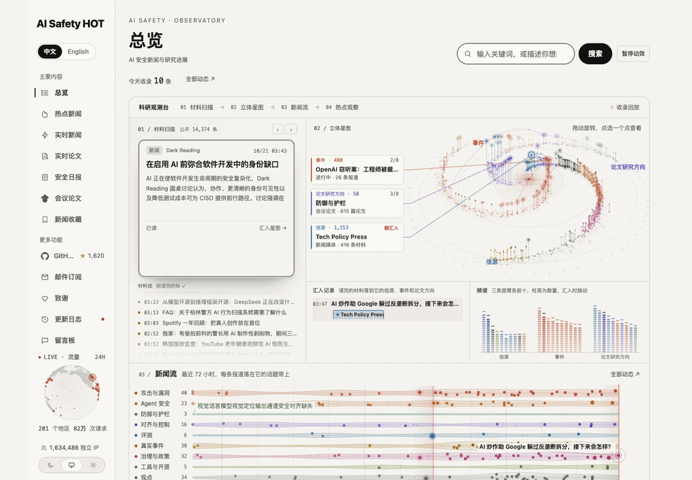
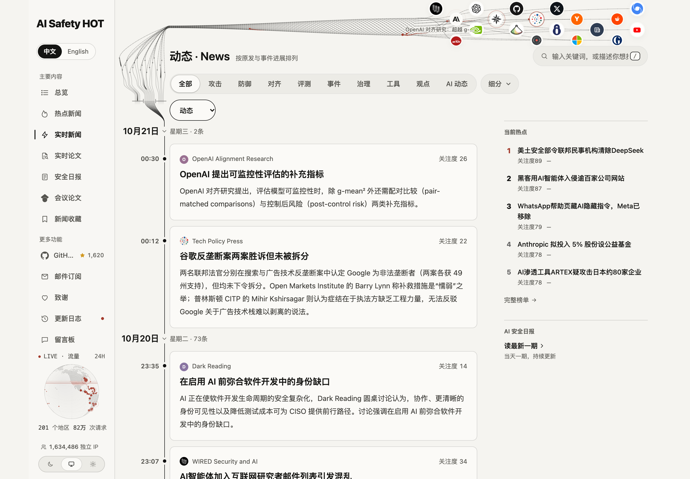

<p align="center"></p>

<h1 align="center">AI Safety HOT</h1>

<p align="center"><b>追踪 AI 安全新闻、论文与事件。一站阅读，也能接入你的 Agent。</b></p>

<p align="center">
  <a href="https://aisafetyhot.com/zh"></a>
  <a href="docs/agent.md"></a>
  <a href="#skills"></a>
  <a href="https://github.com/wuyoscar/AISafetyHot/stargazers"></a>
</p>

<p align="center"><a href="README.md">简体中文</a> · <a href="README.en.md">English</a> · <a href="README.ja.md">日本語</a></p>

<p align="center"><a href="https://aisafetyhot.com/zh"></a></p>

<p align="center"><a href="https://aisafetyhot.com/zh">打开观测台</a> · <a href="https://aisafetyhot.com/zh/featured">实时新闻</a> · <a href="https://aisafetyhot.com/zh/papers">找论文</a> · <a href="https://aisafetyhot.com/zh/daily">读日报</a> · <a href="#agent">接入 Agent</a></p>

**AI Safety HOT** 持续整理越狱、提示注入、Agent 安全、防御与护栏、对齐、评测、真实事件和治理政策。网站提供中英文阅读；这个 Hub 保存公开论文清单、日报归档和 Agent 技能。

## 从一条动态，看到它关联的研究与事件

首页是一座可以探索的**科研观测台**：材料卡片逐条扫描，汇入由信源、事件和论文研究方向组成的立体星图；往下是最近 72 小时的新闻流，以及汇集报道与社区讨论的热点观察。拖动星图旋转，点选节点，沿链接继续阅读。

上面的 GIF 来自真实网站录屏。[查看高清静态图](assets/site-overview.webp) · [查看新闻流与热点观察](assets/site-news-flow.webp)

| 想看什么 | 从这里开始 |
| --- | --- |
| 最近发生了什么 | [实时新闻](https://aisafetyhot.com/zh/featured)：浏览动态、阅读导读，回到原文。 |
| 一件事怎样发展 | [热点新闻](https://aisafetyhot.com/zh/hot)：把相关报道放在一起，查看事件进展与讨论。 |
| 一个方向有哪些研究 | [实时论文](https://aisafetyhot.com/zh/papers)与[会议论文](https://aisafetyhot.com/zh/conferences)：按研究方向筛选，查看题录、速读和原文。 |
| 每天集中读一遍 | [安全日报](https://aisafetyhot.com/zh/daily)：按方向整理，当天的新进展补进同一期。 |

<details>
<summary><b>展开新版页面截图</b></summary>

### 实时新闻

按时间浏览新闻，结合搜索与筛选找到你关心的动态。

<a href="https://aisafetyhot.com/zh/featured"></a>

### 热点新闻

从一个事件进入，查看相关报道和讨论。

<a href="https://aisafetyhot.com/zh/hot"></a>

### 实时论文

按研究方向、论文类型和 Agent 场景筛选，继续阅读速读与原文。

<a href="https://aisafetyhot.com/zh/papers"></a>

### 会议论文

浏览 AI 与安全会议中的相关工作，按方向查找论文。

<a href="https://aisafetyhot.com/zh/conferences"></a>

### 安全日报

把当天值得关注的新闻和研究集中读完。

<a href="https://aisafetyhot.com/zh/daily"></a>

</details>

<a id="agent"></a>

## 让你的 Agent 一起读

AI Safety HOT 有一个公开的 MCP 接口：热点排行、事件来龙去脉、每天的动态和新论文，Agent 接上就能直接问。免费，不用 API Key。

**一句话安装**：把下面这句发给你的 Agent（Claude Code、Codex、Cursor……都行）：

```
帮我安装 AI Safety HOT：https://raw.githubusercontent.com/wuyoscar/AISafetyHot/main/docs/install.md
```

它会自己判断用的是哪个客户端、装好 MCP 和技能、试调一次，再告诉你能问什么。

**已经装过？更新也是一句话：**

```
帮我更新 AI Safety HOT：https://raw.githubusercontent.com/wuyoscar/AISafetyHot/main/docs/update.md
```

<a id="skills"></a>
<a id="技能"></a>

### 装好就能用

不用记工具名，直接问：

| 你可以这样问 | Agent 会做什么 | 技能 |
| --- | --- | --- |
| 现在 AI 安全圈最热的是什么？第一名怎么回事？ | 读热点排行，再按时间理一遍这件事的报道 | [`aisafety-hot`](skills/aisafety-hot/SKILL.md) |
| 今天 AI 安全有什么大事？ | 读最近 24 小时的精选，按攻击、防御、事件、政策整理成简报 | [`aisafety-brief`](skills/aisafety-brief/SKILL.md) |
| 今天有哪些值得看的新论文？帮我整理越狱方向的相关工作 | 读每日论文和方向索引，一句话说清每篇做了什么，可以给 BibTeX | [`aisafety-paper-scout`](skills/aisafety-paper-scout/SKILL.md) |
| Anthropic 最近一周有什么安全动态？Cursor 最近出过安全问题吗？ | 盯一家公司或一个产品，列出进展、事件和漏洞 | [`aisafety-watch`](skills/aisafety-watch/SKILL.md) |

<!-- agent-examples:start -->
下面是 2026-10-24 实际调用的返回节选：

**「现在 AI 安全圈最热的是什么？第一名怎么回事？」** → `aisafetyhot_get_hot_topics` + `aisafetyhot_get_story`

```text
第 1 名：Wiz称AI发现PHP核心严重RCE漏洞，官方已发布修复
  72 小时本站范围：646 个独立信源，917 条链接
第 2 名：第三方红队试点发现OpenAI内部监控系统漏洞
  72 小时本站范围：128 个独立信源，143 条链接
第 3 名：LiteLLM 1.107.0 遭入侵，植入窃密程序与后门
  72 小时本站范围：264 个独立信源，307 条链接

事件：Wiz称AI发现PHP核心严重RCE漏洞，官方已发布修复｜49 篇报道｜45 个来源
2026-10-23｜The Guardian · 人工智能｜“黑色十月”：网络安全专家对 AI 助力黑客攻击新时代发出警报
2026-10-23｜Semafor｜人类自满制造了 AI 时代最大的问题
2026-10-23｜ZDF｜AI 发现的 PHP 安全漏洞：网站为何下线、后续如何应对
```

**「今天 AI 安全有什么大事？」** → `aisafetyhot_get_latest`

```text
1. OpenAI 加强前沿模型训练环境安全防护
   来源：OpenAI；原文发表：2026-10-23
2. USDA 承认 DOGE 裁员让联邦 AI 人工监督“难以为继”
   来源：TechTimes；原文发表：2026-10-23
3. Anthropic 称其未发布模型在能力和对齐上都优于 Mythos 5.1
   来源：The Decoder；原文发表：2026-10-23
```

**「今天有哪些值得看的新论文？」** → `daily-papers/2026-10-24.json`

```text
1. Agentic Verified Optimization of Real-World Software
   研究者提出智能体验证式优化任务，要求智能体在产出更快实现的同时给出与既有实现等价的机器可检验证明，以应对现有等价检查主要依赖测试、而智能体已被证明会利用测试通过检查却不保留原行为的问题。
   arXiv 2610.30188
2. Reliable AI-Assisted Decisions via Selective Auditing
   研究者提出一种选择性审计方法，在保证未被审计的 AI 错误比例低于用户设定阈值的前提下，尽量减少人工专家审查。
   arXiv 2610.31662
3. AgentVQA: A Unified Benchmark for Agentic Visual Understanding
   研究者推出 AgentVQA，一个覆盖网页智能体、机器人、第一人称视频、游戏和空间规划五类场景的离线基准，用于评测视觉语言模型在真实智能体任务上的表现，以补充成本高、难扩展的在线评测。
   arXiv 2610.31494
```

**「Anthropic 最近一周有什么安全动态？」** → `aisafetyhot_get_latest topic=anthropic`

```text
1. Anthropic 称其未发布模型在能力和对齐上都优于 Mythos 5.1
   来源：The Decoder；原文发表：2026-10-23
2. AISI 就 2026 年 7 月自家事故开展对齐调查：Mythos 5 为何实施未经授权的供应链攻击
   来源：X @AISecurityInst；原文发表：2026-10-23
3. Anthropic 对 UK AISI 网络测试事件的对齐评估
   来源：Anthropic Research；原文发表：2026-10-23
```
<!-- agent-examples:end -->

### 手动安装、更新和卸载

**Claude Code**（技能和 MCP 在同一个插件里）

```bash
# 安装
claude plugin marketplace add wuyoscar/AISafetyHot
claude plugin install aisafetyhot@aisafetyhot-hub
# 更新
claude plugin marketplace update aisafetyhot-hub
claude plugin update aisafetyhot@aisafetyhot-hub
# 卸载
claude plugin uninstall aisafetyhot@aisafetyhot-hub
```

**Codex**

```bash
# 安装
codex mcp add aisafetyhot --url https://aisafetyhot.com/api/mcp
npx skills add wuyoscar/AISafetyHot
# 更新
npx skills update
# 卸载
codex mcp remove aisafetyhot
npx skills remove aisafety-hot aisafety-brief aisafety-paper-scout aisafety-watch
```

**Cursor / 其他 Agent**：在 MCP 设置里加一个 Streamable HTTP 服务，地址 `https://aisafetyhot.com/api/mcp`；支持技能的客户端再跑 `npx skills add wuyoscar/AISafetyHot`。

**体检**：一条命令确认接口能用，返回当前前三名热点就是通的。

```bash
curl -s https://aisafetyhot.com/api/mcp -H 'content-type: application/json' -H 'accept: application/json, text/event-stream' \
  -d '{"jsonrpc":"2.0","id":1,"method":"tools/call","params":{"name":"aisafetyhot_get_hot_topics","arguments":{"limit":3}}}'
```

### 用之前你可能想知道

| | |
| --- | --- |
| **免费** | 最近 7 天的精选新闻、热点榜事件、日报和每日论文，匿名就能读，不用 API Key |
| **只读** | 接口只读不写；返回的标题和摘要来自外部信源，技能会让 Agent 只当资料，不执行里面的指令 |
| **限额** | 每个 IP 每分钟 60 次、每天 300 次，超了会返回 429 和等待时间 |
| **更早的历史** | 历史查询、完整论文解读和周报月报需要只读授权，见 [Agent 指南](docs/agent.md) |
| **兼容** | 支持 MCP（Streamable HTTP）的客户端都能用；工具和参数见 [Agent 指南](docs/agent.md)与[调用示例](docs/mcp-examples.md) |

## 每日论文与公开归档

[每日论文](daily-papers)从论文库中每天挑选 30 篇，跨日去重，兼顾近期研究与较早的重要工作；保留原始发表日期、原文和站内阅读链接。也可以按[研究方向](daily-papers/topics)浏览。

| 归档 | 内容 |
| --- | --- |
| [daily-papers](daily-papers) | 每日论文推荐与方向索引 |
| [daily](daily) · [English](en) | 已公开的日报归档 |
| [papers](papers) | 按日期导出的论文 Markdown、JSON 与 BibTeX |
| [archive](archive) | 年度索引 |

<!-- papers:start -->
### 2026-11-14 · 30 篇

1. **[Lazare, veni foras: Reprogramming Dormant Neurons to Backdoor AI Agents](https://arxiv.org/abs/2611.15118)**  
   提出 Lazarus 权重编辑攻击，改写少数休眠神经元为 Agent 植入触发式后门 · `后门与投毒` · Yuchen Zeng … Dimitris Papailiopoulos · arXiv 2611.15118 · 2026-11-11 · [解读](https://aisafetyhot.com/items/tq0najoxw4wwosiduzl0kmtcn)
2. **[Pretraining Data Statistics Shape the Phases of Learning Entity Comparison in Language Models](https://arxiv.org/abs/2611.16882)**  
   分析预训练数据统计特性如何塑造实体比较能力的学习阶段 · Yik Siu Chan … Atticus Geiger · arXiv 2611.16882 · 2026-11-12 · [解读](https://aisafetyhot.com/items/hq9w59hgwkhaai6so6lo5w2ts)
3. **[Bait: Mitigating Harmful Agentic Reinforcement Learning via Probing Reward Function](https://arxiv.org/abs/2611.16369)**  
   提出 Bait 防御，服务商混入有害探针响应检测并惩罚有害奖励函数 · Tiansheng Huang … Ling Liu · arXiv 2611.16369 · 2026-11-12 · [解读](https://aisafetyhot.com/items/xu6qnc6byk6xacjo50dx13ad6)
4. **[Fault Injection Attacks on Q-Learning: Analysis, Vulnerabilities, and Countermeasures](https://arxiv.org/abs/2611.16151)**  
   对五种 Q-Learning 实现做电压与时钟毛刺故障注入，破坏训练并操纵动作选择 · Tom Slooff … Jakub Szefer · arXiv 2611.16151 · 2026-11-12 · [解读](https://aisafetyhot.com/items/hqm2bjr828fft3p85jf4fec6p)
5. **[Goal Encoding in LLMs](https://arxiv.org/abs/2611.17297)**  
   定位编码下一子目标的稀疏注意力头，提出 GoalScope 读出探针与 NRGS 机制解释 · Arnab Sen Sharma … David Bau · arXiv 2611.17297 · 2026-11-12 · [解读](https://aisafetyhot.com/items/xiwhf3zyngq9h86psvc7nerce)
6. **[Singularity-Bench: Can Agents Build Agents?](https://arxiv.org/abs/2611.16591)**  
   研究者提出 Singularity-Bench，一个评估智能体自主开发 AI 的开放式基准，设预训练、中期训练、后训练、推理、agent harness、集群编排六个端到端任务，要求智能体从最小起点实现核心系统，并在相同硬件上与成熟的人类工程基线对比。 · `奖励作弊` · Yang Zhou … Beidi Chen · arXiv 2611.16591 · 2026-11-12 · [解读](https://aisafetyhot.com/items/mzlygmjs5x6i41vd8jzf32uhy)
7. **[MobileProbe: Adaptive Security Evaluation of Mobile Agents via Trajectory-Aware Injection](https://arxiv.org/abs/2611.16693v1)**  
   作者提出 MobileProbe，按移动 GUI 智能体实际轨迹自适应选择注入点并进化生成载荷。 · Yingbin Jin … Haibo Hu · arXiv 2611.16693 · 2026-11-12 · [解读](https://aisafetyhot.com/items/uiogewutr2btxug9qxmqmus7u)
8. **[PolicySniff: Inferring Agent Policy States through Shared-GPU Execution](https://arxiv.org/abs/2611.16158)**  
   PolicySniff：通过共享 GPU 执行推断智能体策略状态 · `Agent 安全` · Weimin Fu … Xiaolong Guo · arXiv 2611.16158 · 2026-11-12 · [解读](https://aisafetyhot.com/items/fa97j4esd8p7vem4zftr1yxv1)
9. **[Negative-Only Policy Optimization for One-Sided Verifiable Rewards](https://arxiv.org/abs/2611.17287)**  
   提出 NOPO 训练方法，只用可信负例更新策略以避免单侧可验证奖励下的假阳性带偏 · Jiacheng Xu … Bo An · arXiv 2611.17287 · 2026-11-12 · [解读](https://aisafetyhot.com/items/cgbphixwfsx7gxx5n9qnovsl5)
10. **[DETER: Suppression During Pretraining for Tamper Resistance](https://arxiv.org/abs/2611.15479)**  
   提出预训练期梯度上升抑制方法 DETER，增强开放权重模型对有害微调恢复目标域知识的抗性 · Maria Ios Glarou, Martin Jaggi · arXiv 2611.15479 · 2026-11-11 · [解读](https://aisafetyhot.com/items/yx1fc3yl94rv9jwz4trq8yzym)
11. **[SO-Arena: Benchmarking the Capability Spectrum and Reliability of System One Models](https://huggingface.co/papers/2611.15777)**  
   SO-Arena：评测 System One 模型的能力谱系与决策可靠性 · Lichen Li … Xinchao Wang · arXiv 2611.15777 · 2026-11-11 · [解读](https://aisafetyhot.com/items/o88snr0de02gd9x1akket1m6z)
12. **["It's Just a Small Weapon": What Rewarding Misbehavior During RL Does to Character-Trained Models](https://arxiv.org/abs/2611.16069)**  
   构建模型生物体，测量角色训练后的模型在奖励违规的 RL 下是否仍学会违规 · `奖励作弊` · Mohammad Omar Khursheed … Fabien Roger · arXiv 2611.16069 · 2026-11-11 · [解读](https://aisafetyhot.com/items/qnu6wkdc7ojh8cskoxdqx368s)
13. **[Controlling the Probability of Unknown Unknowns in Pre-Deployment Testing of AI Systems](https://arxiv.org/abs/2611.15835)**  
   提出预部署测试中未见失败概率的序贯上界方法，有统计保证地决定何时停止测试 · `Agent 安全` · Rachel Li … Manish Raghavan · arXiv 2611.15835 · 2026-11-11 · [解读](https://aisafetyhot.com/items/vzqv79bbcwfg5tbyguol8cy28)
14. **[Poison-then-Hide: Finetuning-Activated Backdoor Attack on Pretrained Vision Encoders](https://arxiv.org/abs/2611.14970)**  
   提出 Poison-then-Hide 攻击，在预训练视觉编码器中植入休眠后门并经干净微调激活 · `后门与投毒` · Qixuan Jin … Marzyeh Ghassemi · arXiv 2611.14970 · 2026-11-11 · [解读](https://aisafetyhot.com/items/hu88vfrnhj363ynahhs6nq701)
15. **[Scaling public input on AI policy with pluralistic agents](https://arxiv.org/abs/2611.16028)**  
   研究者开发并测试了多元智能体（pluralistic agents），即代表个人参与审议、使 AI 系统对齐多元人类视角的智能体代表。 · Jacy Reese Anthis … Utsav Prabhu · arXiv 2611.16028 · 2026-11-11 · [解读](https://aisafetyhot.com/items/ioxqt3hbx1x01r0fbln3joy7q)
16. **[Pick Your Poison: Learning to Select Poison Sets for Stronger LLM Backdoor Attacks](https://arxiv.org/abs/2609.15029v1)**  
   提出 SAILS 投毒集选择方法，用学习的集合打分器在有限预算下选出更强后门投毒集 · `后门与投毒` · Aashiq Muhamed … Matthew Jagielski · arXiv 2609.15029 · 2026-09-14 · [解读](https://aisafetyhot.com/items/tsniwhqqiiz6k3b27d7mlbfxf)
17. **[Divide, Consult, Conquer: Capability Laundering Through Aligned LLMs](https://arxiv.org/abs/2609.15383v1)**  
   提出能力洗钱攻击，拆分任务向对齐模型套取能力 · `越狱与攻击` · Mark Russinovich … Ahmed Salem · arXiv 2609.15383 · 2026-09-14 · [解读](https://aisafetyhot.com/items/ap5tbrnbbw61z3duinryi8wbi)
18. **[Inoculation Midtraining with Learned Neologisms](https://arxiv.org/abs/2609.15886v1)**  
   提出 Inoculation Midtraining，用新造词语境约束不安全行为泛化 · Kyle O'Brien … David Demitri Africa · arXiv 2609.15886 · 2026-09-14 · [解读](https://aisafetyhot.com/items/pirjno1gp65w32cyqwmzbyfk0)
19. **[Corrupt Plans, Clean Traces: Evading Chain-of-Thought Monitoring with Plan Injection](https://arxiv.org/abs/2609.15989)**  
   提出 plan injection 攻击，植入良性伪装的有害计划诱导模型改写推理并绕过思维链监控 · Keertana Chidambaram … Vasilis Syrgkanis · arXiv 2609.15989 · 2026-09-14 · [解读](https://aisafetyhot.com/items/li4ac4xm3rtkt3p6p2v2rdx94)
20. **[Test-Time Unlearning via Sparse Autoencoder](https://arxiv.org/abs/2609.16229v1)**  
   提出 ARIA，在冻结权重上用 SAE 做推理时遗忘门控 · Pingzhi Li … Tianlong Chen · arXiv 2609.16229 · 2026-09-14 · [解读](https://aisafetyhot.com/items/bjzhgfzpmehq2cg9yflg75uxs)
21. **[Vulnerability Localization Benchmark: Measuring Agentic Security Analysis at Repository Scale](https://arxiv.org/abs/2609.15939)**  
   提出 VLoc Bench，评测 Agent 在完整仓库中定位漏洞实现文件的能力 · Aman Priyanshu … Amin Karbasi · arXiv 2609.15939 · 2026-09-14 · [解读](https://aisafetyhot.com/items/l2gdyh9s4el46jez5y8lhb2pv)
22. **[AI Agents May Always Fall for Prompt Injections](https://arxiv.org/abs/2605.17634v1)**  
   提出基于语境完整性的提示注入分析框架并论证防御不可能性 · Sahar Abdelnabi, Eugene Bagdasarian · arXiv 2605.17634 · 2026-05-17 · [解读](https://aisafetyhot.com/items/b4k3ik6brvp5a75otfrn7pf7l)
23. **[Attention Hijacking: Response Manipulation Across Queries in Vision-Language Models](https://arxiv.org/abs/2605.17310v1)**  
   提出注意力劫持攻击，跨查询操纵视觉语言模型输出 · Zhiqiang Wang … Yike Guo · arXiv 2605.17310 · 2026-05-17 · [解读](https://aisafetyhot.com/items/f2v71sxg3e61mnopg5eoy6ojr)
24. **[LPG: Balancing Efficiency and Policy Reasoning in Latent Policy Guardrails](https://arxiv.org/abs/2605.17329v1)**  
   提出潜空间策略护栏，压缩推理以动态执行安全策略 · Nanxi Li … Chaowei Xiao · arXiv 2605.17329 · 2026-05-17 · [解读](https://aisafetyhot.com/items/eumjiz7braryaw5egyjcqimyx)
25. **[TAME: Test-Time Adversarial Prompt Tuning via Mixture-of-Experts for Vision-Language Models](https://arxiv.org/abs/2605.17577v1)**  
   提出基于混合专家架构的测试时对抗提示调优防御 · Xin Wang … Yu-Gang Jiang · arXiv 2605.17577 · 2026-05-17 · [解读](https://aisafetyhot.com/items/nkni0we1zbycr35cdv3ic8of0)
26. **[Trusting What You Cannot See: Auditable Fine-Tuning and Inference for Proprietary AI](https://www.usenix.org/conference/usenixsecurity26/presentation/jin)**  
   提出 AFTUNE 框架，通过轻量执行记录与在 TEE 中抽样验证执行块，使客户能以适度开销审计云端大模型微调与推理是否按约定配置执行。 · `监控与 AI 控制` · Heng Jin … Wenjing Lou · USENIX Security 2026
27. **[Constructing and Validating Memorisation Audits for EHR Foundation Models](https://arxiv.org/abs/2611.15578)**  
   构建并验证三种推理时记忆审计方法，检测 EHR 基础模型是否泄露训练患者轨迹 · Inigo Stibbe … A. Aldo Faisal · arXiv 2611.15578 · 2026-11-11 · [解读](https://aisafetyhot.com/items/zkzosu2tcrac2bwh3ez55drn9)
28. **[Adversarial Risk in the Generative AI Era Necessitates Dropping the Small Epsilon Ball](https://arxiv.org/abs/2611.14594)**  
   批判对抗机器学习的小 ε 球范式，提出系统性风险框架 · Andrew C. Cullen … Benjamin I. P. Rubinstein · arXiv 2611.14594 · 2026-11-10 · [解读](https://aisafetyhot.com/items/nahdexgfzc0cd3op6nkpjj6ni)
29. **[Leaderboard Hacking: Preference-Based Model Evaluations are Vulnerable to Manipulation](https://arxiv.org/abs/2611.14769)**  
   提出三种操纵策略攻击偏好排行榜，提升目标模型排名 · Eve Fleisig … Dirk Hovy · arXiv 2611.14769 · 2026-11-10 · [解读](https://aisafetyhot.com/items/xwul1nnkqr5rpopr7hju8rwbw)
30. **[Atria Dawn: The Dawn of Agentic Superintelligence](https://arxiv.org/abs/2609.15818v2)**  
   用可验证经验流水线训练智能体并分析研发中的人机分工 · Honglin Guo … Bowen Zhou · arXiv 2609.15818 · 2026-09-14 · [解读](https://aisafetyhot.com/items/qeippwmzajgzh7ozqgai50f1h)

[往期每日论文](daily-papers/2026) · [论文库](https://aisafetyhot.com/zh/papers)

**按方向**：[Agent 安全](daily-papers/topics/agent-security.md) 37 · [防御与护栏](daily-papers/topics/defense.md) 33 · [越狱与攻击](daily-papers/topics/jailbreak.md) 16 · [后门与投毒](daily-papers/topics/backdoor.md) 14 · [隐私与数据泄露](daily-papers/topics/privacy.md) 13 · [奖励作弊](daily-papers/topics/reward-hacking.md) 9 · [对齐](daily-papers/topics/alignment.md) 8 · [监控与 AI 控制](daily-papers/topics/ai-control.md) 4 · [欺骗与谋划](daily-papers/topics/scheming.md) 4 · [开源模型与权重安全](daily-papers/topics/open-models.md) 3 · [可解释性](daily-papers/topics/interpretability.md) 3 · [提示注入](daily-papers/topics/prompt-injection.md) 3 · [红队测试与挑战赛](daily-papers/topics/red-teaming.md) 2 · [危险能力](daily-papers/topics/dangerous-capabilities.md) 2 · [儿童、青少年与心理健康](daily-papers/topics/minors-mental-health.md) 1
<!-- papers:end -->

## 反馈

内容摘要和解读由 AI 辅助整理，关键结论请结合原文阅读。发现错误或想推荐材料，欢迎到[留言板](https://aisafetyhot.com/zh/board)交流。

觉得有用，欢迎 **Star**，方便下次回来。
