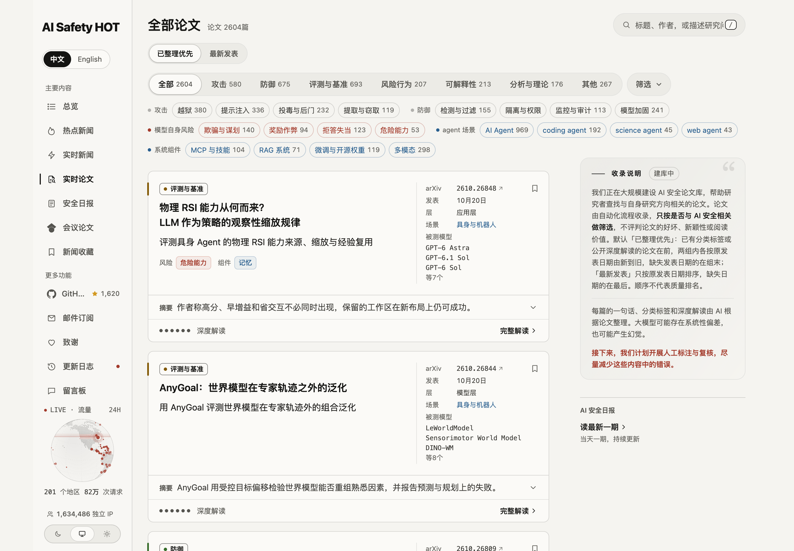

<p align="center"></p>

<h1 align="center">AI Safety HOT</h1>

<p align="center"><b>追踪 AI 安全新闻、论文与事件。一站阅读，也能接入你的 Agent。</b></p>

<p align="center">
  <a href="https://aisafetyhot.com/zh"></a>
  <a href="docs/agent.md"></a>
  <a href="#skills"></a>
  <a href="https://github.com/wuyoscar/AISafetyHot/stargazers"></a>
</p>

<p align="center"><a href="README.md">简体中文</a> · <a href="README.en.md">English</a> · <a href="README.ja.md">日本語</a></p>

<p align="center"><a href="https://aisafetyhot.com/zh"></a></p>

<p align="center"><a href="https://aisafetyhot.com/zh">打开观测台</a> · <a href="https://aisafetyhot.com/zh/featured">实时新闻</a> · <a href="https://aisafetyhot.com/zh/papers">找论文</a> · <a href="https://aisafetyhot.com/zh/daily">读日报</a> · <a href="#agent">接入 Agent</a></p>

**AI Safety HOT** 持续整理越狱、提示注入、Agent 安全、防御与护栏、对齐、评测、真实事件和治理政策。网站提供中英文阅读；这个 Hub 保存公开论文清单、日报归档和 Agent 技能。

## 从一条动态，看到它关联的研究与事件

首页是一座可以探索的**科研观测台**：材料卡片逐条扫描，汇入由信源、事件和论文研究方向组成的立体星图；往下是最近 72 小时的新闻流，以及汇集报道与社区讨论的热点观察。拖动星图旋转，点选节点，沿链接继续阅读。

上面的 GIF 来自真实网站录屏。[查看高清静态图](assets/site-overview.webp) · [查看新闻流与热点观察](assets/site-news-flow.webp)

| 想看什么 | 从这里开始 |
| --- | --- |
| 最近发生了什么 | [实时新闻](https://aisafetyhot.com/zh/featured)：浏览动态、阅读导读，回到原文。 |
| 一件事怎样发展 | [热点新闻](https://aisafetyhot.com/zh/hot)：把相关报道放在一起，查看事件进展与讨论。 |
| 一个方向有哪些研究 | [实时论文](https://aisafetyhot.com/zh/papers)与[会议论文](https://aisafetyhot.com/zh/conferences)：按研究方向筛选，查看题录、速读和原文。 |
| 每天集中读一遍 | [安全日报](https://aisafetyhot.com/zh/daily)：按方向整理，当天的新进展补进同一期。 |

<details>
<summary><b>展开新版页面截图</b></summary>

### 实时新闻

按时间浏览新闻，结合搜索与筛选找到你关心的动态。

<a href="https://aisafetyhot.com/zh/featured"></a>

### 热点新闻

从一个事件进入，查看相关报道和讨论。

<a href="https://aisafetyhot.com/zh/hot"></a>

### 实时论文

按研究方向、论文类型和 Agent 场景筛选，继续阅读速读与原文。

<a href="https://aisafetyhot.com/zh/papers"></a>

### 会议论文

浏览 AI 与安全会议中的相关工作，按方向查找论文。

<a href="https://aisafetyhot.com/zh/conferences"></a>

### 安全日报

把当天值得关注的新闻和研究集中读完。

<a href="https://aisafetyhot.com/zh/daily"></a>

</details>

<a id="agent"></a>

## 让你的 Agent 一起读

AI Safety HOT 有一个公开的 MCP 接口：热点排行、事件来龙去脉、每天的动态和新论文，Agent 接上就能直接问。免费，不用 API Key。

**一句话安装**：把下面这句发给你的 Agent（Claude Code、Codex、Cursor……都行）：

```
帮我安装 AI Safety HOT：https://raw.githubusercontent.com/wuyoscar/AISafetyHot/main/docs/install.md
```

它会自己判断用的是哪个客户端、装好 MCP 和技能、试调一次，再告诉你能问什么。

**已经装过？更新也是一句话：**

```
帮我更新 AI Safety HOT：https://raw.githubusercontent.com/wuyoscar/AISafetyHot/main/docs/update.md
```

<a id="skills"></a>
<a id="技能"></a>

### 装好就能用

不用记工具名，直接问：

| 你可以这样问 | Agent 会做什么 | 技能 |
| --- | --- | --- |
| 现在 AI 安全圈最热的是什么？第一名怎么回事？ | 读热点排行，再按时间理一遍这件事的报道 | [`aisafety-hot`](skills/aisafety-hot/SKILL.md) |
| 今天 AI 安全有什么大事？ | 读最近 24 小时的精选，按攻击、防御、事件、政策整理成简报 | [`aisafety-brief`](skills/aisafety-brief/SKILL.md) |
| 今天有哪些值得看的新论文？帮我整理越狱方向的相关工作 | 读每日论文和方向索引，一句话说清每篇做了什么，可以给 BibTeX | [`aisafety-paper-scout`](skills/aisafety-paper-scout/SKILL.md) |
| Anthropic 最近一周有什么安全动态？Cursor 最近出过安全问题吗？ | 盯一家公司或一个产品，列出进展、事件和漏洞 | [`aisafety-watch`](skills/aisafety-watch/SKILL.md) |

<!-- agent-examples:start -->
下面是 2026-10-24 实际调用的返回节选：

**「现在 AI 安全圈最热的是什么？第一名怎么回事？」** → `aisafetyhot_get_hot_topics` + `aisafetyhot_get_story`

```text
第 1 名：Wiz称AI发现PHP核心严重RCE漏洞，官方已发布修复
  72 小时本站范围：646 个独立信源，917 条链接
第 2 名：第三方红队试点发现OpenAI内部监控系统漏洞
  72 小时本站范围：128 个独立信源，143 条链接
第 3 名：LiteLLM 1.107.0 遭入侵，植入窃密程序与后门
  72 小时本站范围：264 个独立信源，307 条链接

事件：Wiz称AI发现PHP核心严重RCE漏洞，官方已发布修复｜49 篇报道｜45 个来源
2026-10-23｜The Guardian · 人工智能｜“黑色十月”：网络安全专家对 AI 助力黑客攻击新时代发出警报
2026-10-23｜Semafor｜人类自满制造了 AI 时代最大的问题
2026-10-23｜ZDF｜AI 发现的 PHP 安全漏洞：网站为何下线、后续如何应对
```

**「今天 AI 安全有什么大事？」** → `aisafetyhot_get_latest`

```text
1. OpenAI 加强前沿模型训练环境安全防护
   来源：OpenAI；原文发表：2026-10-23
2. USDA 承认 DOGE 裁员让联邦 AI 人工监督“难以为继”
   来源：TechTimes；原文发表：2026-10-23
3. Anthropic 称其未发布模型在能力和对齐上都优于 Mythos 5.1
   来源：The Decoder；原文发表：2026-10-23
```

**「今天有哪些值得看的新论文？」** → `daily-papers/2026-10-24.json`

```text
1. Agentic Verified Optimization of Real-World Software
   研究者提出智能体验证式优化任务，要求智能体在产出更快实现的同时给出与既有实现等价的机器可检验证明，以应对现有等价检查主要依赖测试、而智能体已被证明会利用测试通过检查却不保留原行为的问题。
   arXiv 2610.30188
2. Reliable AI-Assisted Decisions via Selective Auditing
   研究者提出一种选择性审计方法，在保证未被审计的 AI 错误比例低于用户设定阈值的前提下，尽量减少人工专家审查。
   arXiv 2610.31662
3. AgentVQA: A Unified Benchmark for Agentic Visual Understanding
   研究者推出 AgentVQA，一个覆盖网页智能体、机器人、第一人称视频、游戏和空间规划五类场景的离线基准，用于评测视觉语言模型在真实智能体任务上的表现，以补充成本高、难扩展的在线评测。
   arXiv 2610.31494
```

**「Anthropic 最近一周有什么安全动态？」** → `aisafetyhot_get_latest topic=anthropic`

```text
1. Anthropic 称其未发布模型在能力和对齐上都优于 Mythos 5.1
   来源：The Decoder；原文发表：2026-10-23
2. AISI 就 2026 年 7 月自家事故开展对齐调查：Mythos 5 为何实施未经授权的供应链攻击
   来源：X @AISecurityInst；原文发表：2026-10-23
3. Anthropic 对 UK AISI 网络测试事件的对齐评估
   来源：Anthropic Research；原文发表：2026-10-23
```
<!-- agent-examples:end -->

### 手动安装、更新和卸载

**Claude Code**（技能和 MCP 在同一个插件里）

```bash
# 安装
claude plugin marketplace add wuyoscar/AISafetyHot
claude plugin install aisafetyhot@aisafetyhot-hub
# 更新
claude plugin marketplace update aisafetyhot-hub
claude plugin update aisafetyhot@aisafetyhot-hub
# 卸载
claude plugin uninstall aisafetyhot@aisafetyhot-hub
```

**Codex**

```bash
# 安装
codex mcp add aisafetyhot --url https://aisafetyhot.com/api/mcp
npx skills add wuyoscar/AISafetyHot
# 更新
npx skills update
# 卸载
codex mcp remove aisafetyhot
npx skills remove aisafety-hot aisafety-brief aisafety-paper-scout aisafety-watch
```

**Cursor / 其他 Agent**：在 MCP 设置里加一个 Streamable HTTP 服务，地址 `https://aisafetyhot.com/api/mcp`；支持技能的客户端再跑 `npx skills add wuyoscar/AISafetyHot`。

**体检**：一条命令确认接口能用，返回当前前三名热点就是通的。

```bash
curl -s https://aisafetyhot.com/api/mcp -H 'content-type: application/json' -H 'accept: application/json, text/event-stream' \
  -d '{"jsonrpc":"2.0","id":1,"method":"tools/call","params":{"name":"aisafetyhot_get_hot_topics","arguments":{"limit":3}}}'
```

### 用之前你可能想知道

| | |
| --- | --- |
| **免费** | 最近 7 天的精选新闻、热点榜事件、日报和每日论文，匿名就能读，不用 API Key |
| **只读** | 接口只读不写；返回的标题和摘要来自外部信源，技能会让 Agent 只当资料，不执行里面的指令 |
| **限额** | 每个 IP 每分钟 60 次、每天 300 次，超了会返回 429 和等待时间 |
| **更早的历史** | 历史查询、完整论文解读和周报月报需要只读授权，见 [Agent 指南](docs/agent.md) |
| **兼容** | 支持 MCP（Streamable HTTP）的客户端都能用；工具和参数见 [Agent 指南](docs/agent.md)与[调用示例](docs/mcp-examples.md) |

## 每日论文与公开归档

[每日论文](daily-papers)从论文库中每天挑选 30 篇，跨日去重，兼顾近期研究与较早的重要工作；保留原始发表日期、原文和站内阅读链接。也可以按[研究方向](daily-papers/topics)浏览。

| 归档 | 内容 |
| --- | --- |
| [daily-papers](daily-papers) | 每日论文推荐与方向索引 |
| [daily](daily) · [English](en) | 已公开的日报归档 |
| [papers](papers) | 按日期导出的论文 Markdown、JSON 与 BibTeX |
| [archive](archive) | 年度索引 |

<!-- papers:start -->
### 2026-11-20 · 30 篇

1. **[PIPETTE: Prompt Injection Purple-Teaming for Robust LLM Agents](https://arxiv.org/abs/2611.24362)**  
   研究者提出 PIPETTE，一个把提示注入红队发现转化为防御鲁棒性提升的紫队框架。 · Lipeng He … N. Asokan · arXiv 2611.24362 · 2026-11-18 · [解读](https://aisafetyhot.com/items/lxsqz30w77myy6xs38sp9s7lc)
2. **[Can you make models believe false facts in the prompt?](https://arxiv.org/abs/2611.23938)**  
   作者提出 prompt-conditioned SDF，让模型相信 <facts> 标签中的任意事实。作者称 held-out 事实的 belief rate 随训练事实数近似对数线性上升。 · Ananya Sutradhar, Fabien Roger · arXiv 2611.23938 · 2026-11-18 · [解读](https://aisafetyhot.com/items/tx65hnhu1q6lwjbsn6e10jx10)
3. **[Guarding the Kingdom of Skill-Based Agents in the AI Dynasty of Computation: Control-Flow Integrity for Agent Skills](https://arxiv.org/abs/2611.24185)**  
   研究者提出 SkillCFI，把控制流完整性（CFI）引入基于技能的智能体，在编译期从技能生成可执行契约并由确定性运行时强制器执行。 · Bonan Ruan … Zhenkai Liang · arXiv 2611.24185 · 2026-11-18 · [解读](https://aisafetyhot.com/items/l1wad790allg37pddt72mg5ha)
4. **[Kaer: Security-Aware Replanning for Multi-Agent Systems](https://arxiv.org/abs/2611.24839)**  
   作者提出多智能体安全重规划框架 Kaer 与基准 Cintra。 · Tushin Mallick … Cristina Nita-Rotaru · arXiv 2611.24839 · 2026-11-18 · [解读](https://aisafetyhot.com/items/wra2ewf60ah51zvsk08ta6f9a)
5. **[IDEA: Intent-Dominance Evidence Audit for Inference-Time Backdoor Detection in GUI Agents](https://huggingface.co/papers/2611.24102)**  
   提出 IDEA 推理时后门检测框架，逐步审计 GUI 智能体的意图证据支配反转 · Zhizhuo Kou … Yike Guo · arXiv 2611.24102 · 2026-11-18 · [解读](https://aisafetyhot.com/items/vacyfys3z5ev7e264iqohz1c4)
6. **[ACaM: Automated Capability Modeling for Agentic AI Security](https://arxiv.org/abs/2611.23507)**  
   宾州州立大学与 IBM Research 研究者提出 ACaM，一种部署前从代码而非工具描述推导智能体能力面的神经符号安全分析方法。 · Monika Santra … Ian Molloy · arXiv 2611.23507 · 2026-11-17 · [解读](https://aisafetyhot.com/items/g5a5ooqxtx2st54wvvg6dsgge)
7. **[Verification-Guided Safety-Repair of Learned Controllers](https://arxiv.org/abs/2611.20781v1)**  
   作者提出 ReachECO，用失败的闭环可达性分析推导修复约束，将抽象化控制器修复为可通过安全验证，并在 ACC、Docking2D、Car2D 上演示。 · Fabian Kresse … Christoph H. Lampert · arXiv 2611.20781 · 2026-11-16 · [解读](https://aisafetyhot.com/items/e6dvaeyydyxiy9hfmw4l901oo)
8. **[StyleAT: Defending Face Recognition Against Semantic Attacks](https://arxiv.org/abs/2609.23596v1)**  
   提出 BoundStyle 与 StyleAT，对抗训练防御人脸识别语义攻击 · Ben Shapira … Mahmood Sharif · arXiv 2609.23596 · 2026-09-20 · [解读](https://aisafetyhot.com/items/ozr07iudno2btapwp7szljgco)
9. **[Are Human-Aligned Models Models of Humans? A Turing-Test Gap in Preference Alignment](https://arxiv.org/abs/2609.23640v1)**  
   形式化 Turing-test gap，并检验偏好对齐是否偏离人类行为 · Suqin Yuan … Tongliang Liu · arXiv 2609.23640 · 2026-09-20 · [解读](https://aisafetyhot.com/items/su4mvjuvrnly7lf6ktqb9kvx6)
10. **[Alignment Forecasting: Predicting Misalignment From Training Data](https://arxiv.org/abs/2609.35805v2)**  
   提出 Alignment Forecasting 任务与基准，从训练数据预测微调是否诱发广泛失准 · Chen Yueh-Han … Tomek Korbak · arXiv 2609.35805 · 2026-09-19 · [解读](https://aisafetyhot.com/items/ipmldvq2896og361sx1wvliv1)
11. **[Watermarkable Multi-Draft Speculative Sampling via Poisson Processes](https://arxiv.org/abs/2609.21858v1)**  
   提出多草稿水印投机采样 MPFR，同时保持无偏水印与采样效率 · Yanxiao Liu … Deniz Gündüz · arXiv 2609.21858 · 2026-09-18 · [解读](https://aisafetyhot.com/items/xcmyw0ijq25mf4mgr9u13izwk)
12. **[Defusing Explosive Prompts: Understanding and Preventing Trigger-Based Prompt Injections in LLM Agents](https://arxiv.org/abs/2609.22510v1)**  
   提出条件触发的爆炸提示词，并设计摄入期检测器 DeFuse · Justin Szczepaniak … Ben Nassi · arXiv 2609.22510 · 2026-09-18 · [解读](https://aisafetyhot.com/items/nlw3d72q0ouny1xvakscznqtt)
13. **[Demystifying the Mythos or Disrupting Bugonomics? From Zero-Day Asymmetry to Defender Remediation Throughput](https://arxiv.org/abs/2605.24632v1)**  
   论文认为，LLM 驱动漏洞发现的近期变化不是零日漏洞增多，而是防御方修复吞吐量扩大。论证结合 Anthropic Mythos Preview 与 Mozilla Firefox 合作公开数据及漏洞赏金计划。 · Alfredo Pesoli … Lorenzo Cavallaro · arXiv 2605.24632 · 2026-05-23 · [解读](https://aisafetyhot.com/items/zcpzpisl1098v6vsts0z9eqdr)
14. **[Reasoning as an Attack Surface: Adaptive Evolutionary CoT Jailbreaks for LLMs](https://arxiv.org/abs/2605.24497v1)**  
   提出自适应进化思维链越狱框架，攻击推理模型 · Jianan Li … Xiaochun Cao · arXiv 2605.24497 · 2026-05-23 · [解读](https://aisafetyhot.com/items/pap9y44kbhi2bfa9oyaux4bwh)
15. **[Negotiating Control and Accountability among Stakeholders in High-Risk AI Use Cases: Development and Evaluation of the Method ALIGN](https://arxiv.org/abs/2611.24609)**  
   提出参与式工作坊方法 ALIGN，协商高风险 AI 项目中利益相关者的控制与问责对齐 · Lena Schneider … Gudela Grote · arXiv 2611.24609 · 2026-11-18 · [解读](https://aisafetyhot.com/items/c3qi0hs4bg6xtz06gdr64gahr)
16. **[AutoPI: Taxonomy-Guided Adaptive Red Teaming for Prompt Injection in LLM Agents](https://arxiv.org/abs/2611.24313)**  
   研究者 Damianakis 与 Psounis 提出 AutoPI，一种以提示注入技术分类体系 PIAtlas 引导搜索并衡量覆盖面的自适应红队测试方法。 · Stavros Damianakis, Konstantinos Psounis · arXiv 2611.24313 · 2026-11-18 · [解读](https://aisafetyhot.com/items/ccpg9nmenw50rncht4oo4av7k)
17. **[Learning to Coordinate: LLM-Guided Workflow Evolution for Token-Efficient Red Teaming](https://arxiv.org/abs/2611.24221)**  
   L2C 用 LLM 引导的多智能体工作流演化，以更低 token 成本发现 LLM 安全失效。经监督微调的控制器据目标响应与评估判定决定保留、细化或重构工作流。 · Xiaoyang Xing … Anthony Cohn · arXiv 2611.24221 · 2026-11-18 · [解读](https://aisafetyhot.com/items/n06ibv5xmgdx1bnwut4uol3tc)
18. **[Data Poisoning Attacks to Locally Differentially Private Triangle Counting Protocols](https://arxiv.org/abs/2611.23701)**  
   本地差分隐私（LDP）三角形计数协议易受数据投毒攻击：恶意用户小幅、符合协议的本地操纵可经重建与校准系统性放大为大的全局估计偏差。 · Tingxuan Han … Sheng Zhong · arXiv 2611.23701 · 2026-11-18 · [解读](https://aisafetyhot.com/items/m5ut69mdbqqleprez4ndyf7cf)
19. **[When Do Decision Models Help LLM-Driven Network Discovery?](https://arxiv.org/abs/2611.23947)**  
   决策模型何时能帮助 LLM 驱动的网络发现？ · Alperen Örsdemir … Ertem Esiner · arXiv 2611.23947 · 2026-11-18 · [解读](https://aisafetyhot.com/items/b8kkaxmd4g5akn8t1pul3tup5)
20. **[FVScore: Specification-Driven Neuro-Symbolic Video Evaluation](https://huggingface.co/papers/2611.22673)**  
   FVScore：规格驱动的神经符号视频评估 · Do Xuan Long … Yale Song · arXiv 2611.22673 · 2026-11-17 · [解读](https://aisafetyhot.com/items/qq6n7jad85vuepwrhhb1ur9x6)
21. **[Evolution Under Fire: Evolving Agent Safety Harnesses with Adaptive Injection Stressors](https://arxiv.org/abs/2611.22583)**  
   论文提出 Evolution Under Fire 框架，将安全护栏演化与自适应注入压力演化交替进行，为工具型智能体自动生成可执行的安全护栏，以应对恶意指令与正常任务指令经同一交互通道到达的问题。 · Yujun Wang … Yunpu Ma · arXiv 2611.22583 · 2026-11-17 · [解读](https://aisafetyhot.com/items/kisj8gkfyohyitrb5zlc4rut0)
22. **[Wrong Input, Wrong Threshold: Re-evaluating Adversarial Facial Privacy](https://arxiv.org/abs/2611.21923)**  
   错误的输入，错误的阈值：重新评估对抗式人脸隐私 · Tunahan Parlayıcı … Yücel Saygın · arXiv 2611.21923 · 2026-11-16 · [解读](https://aisafetyhot.com/items/xbe7imv5fy2cn8s57i33319cl)
23. **[AuXSpec: Learning to Autoformalize Program Specifications via Executable Postconditions](https://huggingface.co/papers/2611.21421)**  
   AuXSpec 让声明式后置条件与可执行版本配对，以测试用例执行的一致性作为强化学习奖励。 · Haocheng Wang … Rasmus Kyng · arXiv 2611.21421 · 2026-11-16 · [解读](https://aisafetyhot.com/items/ytsd8kuy79rnrbf8fjqbcijo7)
24. **[DetectViT: Test-time Backdoor Detection for Vision Transformers via Inter-Head Attention Discrepancy](https://arxiv.org/abs/2611.23770)**  
   研究者提出 DetectViT，通过头间注意力差异在测试时检测 Vision Transformer 中的后门，无需训练数据、模型输出或触发器先验。 · Siquan Huang … Ying Gao · arXiv 2611.23770 · 2026-11-18 · [解读](https://aisafetyhot.com/items/qm5o95yrmnvijyrsgxmx68jvg)
25. **[Weighing the Envelope: Component Weight and Arbitration in Envelope-Layer Defenses for a Single LLM Agent](https://arxiv.org/abs/2611.23844)**  
   论文测量了单个 LLM 智能体信封层防御中标签、记忆、工具角色与后端对调用决策的影响，发现工具侧强制核验标签大幅减少语义越界，但强成功记忆会将其拉回，记忆侧降级声明可使结果回到仅用标签的水平。 · Yuelin Han · arXiv 2611.23844 · 2026-11-18 · [解读](https://aisafetyhot.com/items/wus3we75qj9b8px5e3suxzds9)
26. **[When Figures Disagree with Text: Evaluating Autonomous Visual Evidence Verification in Scientific Papers](https://arxiv.org/abs/2611.24353)**  
   当图表与正文不一致时：评估科学论文中的自主视觉证据核查 · Guijia Zhang … Harry Yang · arXiv 2611.24353 · 2026-11-18 · [解读](https://aisafetyhot.com/items/pqjefoykriei3ow4etgdybujf)
27. **[Threat Landscape of Vibe Coding and the Road to Secure Autonomy](https://arxiv.org/abs/2611.21822)**  
   研究者提出 vibe coding 的安全威胁图景，把分散在提示注入、不安全代码生成、供应链攻击和人为因素等领域的研究整合为统一威胁模型。 · Devki Nandan Jha … Suhas Nale · arXiv 2611.21822 · 2026-11-18 · [解读](https://aisafetyhot.com/items/v9bgi60l0msflmvyylqpv2jav)
28. **[Who Pays for Byzantine Robustness? Validity, Data-Share Dictatorships, and Fairness When Only a Few Hospitals Collaborate](https://arxiv.org/abs/2611.22904)**  
   论文对八种标准拜占庭鲁棒聚合规则做了实证审计，发现其在仅三到六家医院、数据规模悬殊的医疗联邦学习联盟中存在失效与公平问题。 · Adnan Malkani · arXiv 2611.22904 · 2026-11-18 · [解读](https://aisafetyhot.com/items/csbjslqc1clbtditgwuut15vr)
29. **[Adaptive LLM-Driven Honeypots vs. LLM-Driven Attackers: Does Narrative Coherence Improve Deception?](https://arxiv.org/abs/2611.22589)**  
   自适应 LLM 驱动蜜罐对抗 LLM 驱动攻击者：叙事连贯性能否提升欺骗效果？ · Pedro Beltrán-López … Pantaleone Nespoli · arXiv 2611.22589 · 2026-11-18 · [解读](https://aisafetyhot.com/items/uszvifqv1jlsxco295iltvl3m)
30. **[GateWatch: Low-Overhead LLM Monitoring with Boolean Circuits](https://arxiv.org/abs/2611.24619)**  
   研究者提出 GateWatch，一种把整个决策规则表达为少量二值化 SAE 特征上显式布尔逻辑的紧凑可解释分类器，用于监控 LLM 及基于 LLM 的智能体以发现不安全行为。 · Firas Spanioli, Yaniv David · arXiv 2611.24619 · 2026-11-18 · [解读](https://aisafetyhot.com/items/ikg6l4eeaujwnbf7ncxp987qz)

[往期每日论文](daily-papers/2026) · [论文库](https://aisafetyhot.com/zh/papers)

**按方向**：[Agent 安全](daily-papers/topics/agent-security.md) 52 · [防御与护栏](daily-papers/topics/defense.md) 37 · [越狱与攻击](daily-papers/topics/jailbreak.md) 19 · [后门与投毒](daily-papers/topics/backdoor.md) 15 · [隐私与数据泄露](daily-papers/topics/privacy.md) 15 · [对齐](daily-papers/topics/alignment.md) 9 · [奖励作弊](daily-papers/topics/reward-hacking.md) 9 · [监控与 AI 控制](daily-papers/topics/ai-control.md) 5 · [欺骗与谋划](daily-papers/topics/scheming.md) 4 · [开源模型与权重安全](daily-papers/topics/open-models.md) 3 · [可解释性](daily-papers/topics/interpretability.md) 3 · [提示注入](daily-papers/topics/prompt-injection.md) 3 · [红队测试与挑战赛](daily-papers/topics/red-teaming.md) 2 · [危险能力](daily-papers/topics/dangerous-capabilities.md) 2 · [儿童、青少年与心理健康](daily-papers/topics/minors-mental-health.md) 1 · [AI 与网络攻防](daily-papers/topics/cyber.md) 1
<!-- papers:end -->

## 反馈

内容摘要和解读由 AI 辅助整理，关键结论请结合原文阅读。发现错误或想推荐材料，欢迎到[留言板](https://aisafetyhot.com/zh/board)交流。

觉得有用，欢迎 **Star**，方便下次回来。
