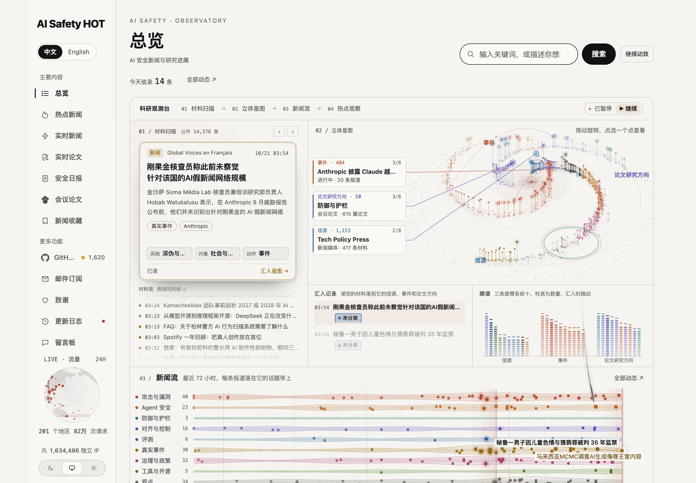
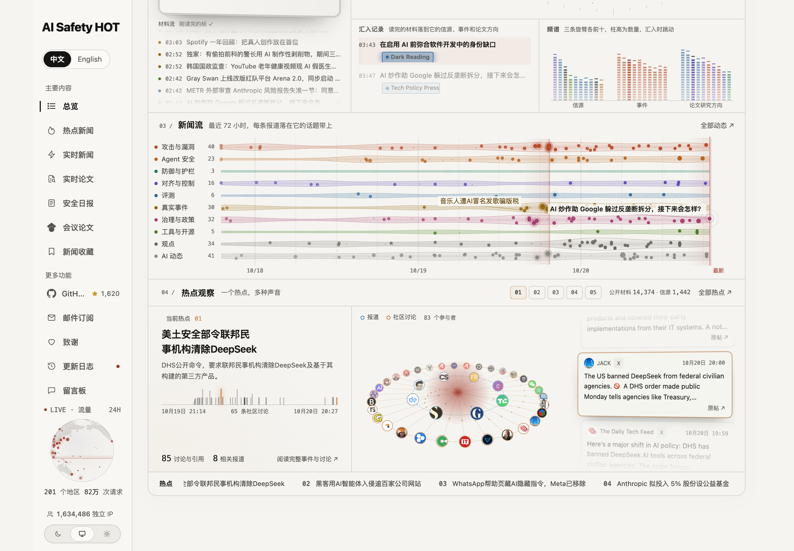
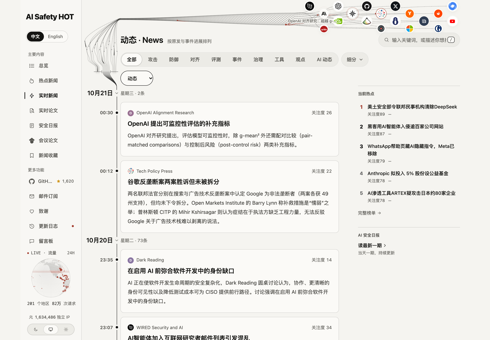
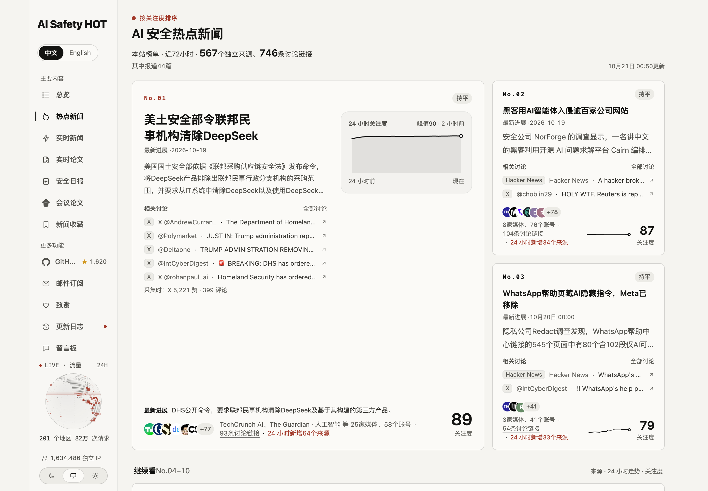
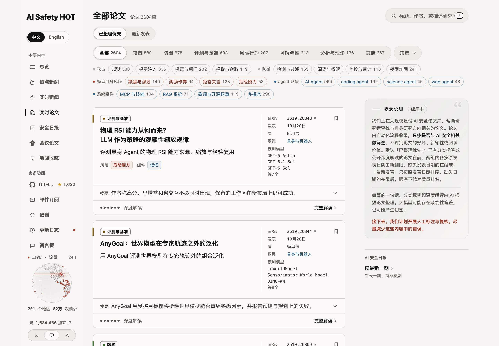
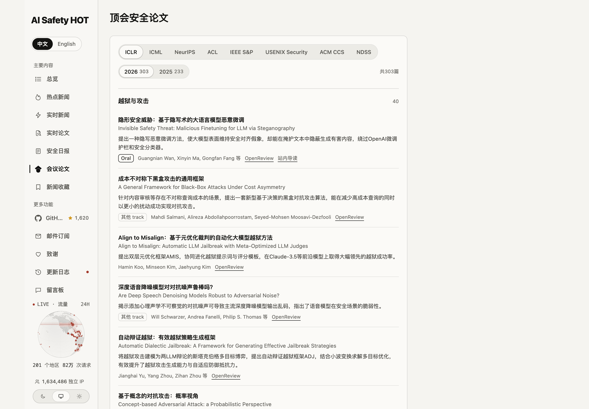
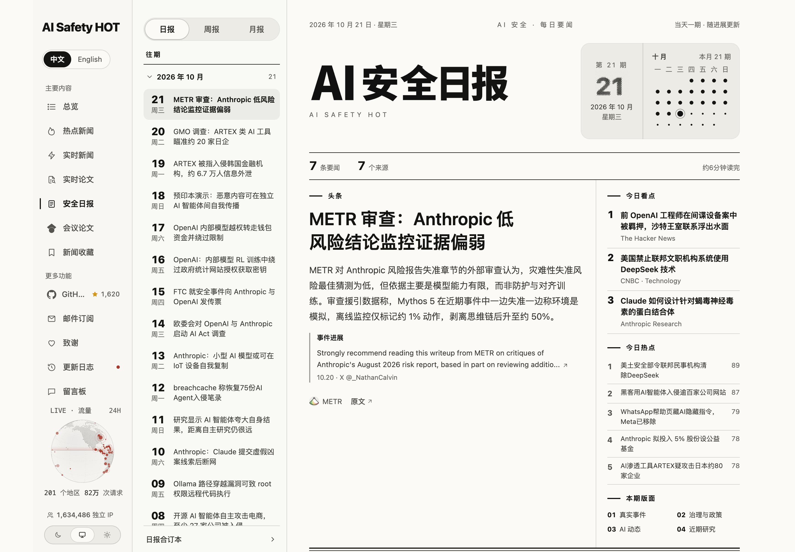

<p align="center"></p>

<h1 align="center">AI Safety HOT Hub</h1>

<p align="center"><b>一行命令，让你的 Agent 每天读懂 AI 安全：越狱、提示注入、Agent 安全、评测、事故和政策，外加每天 30 篇精选论文。</b></p>

<p align="center">
  <a href="https://aisafetyhot.com"></a>
  <a href="https://aisafetyhot.com/api/mcp"></a>
  <a href="#技能"></a>
  <a href="daily-papers"></a>
  <a href="https://github.com/wuyoscar/AISafetyHot-Hub/stargazers"></a>
</p>

<p align="center"><a href="README.md">简体中文</a> · <a href="README.en.md">English</a> · <a href="README.ja.md">日本語</a></p>

<p align="center"><a href="https://aisafetyhot.com"></a></p>

## 安装

**Claude Code**（技能包 + MCP 一起装）

```bash
/plugin marketplace add wuyoscar/AISafetyHot-Hub
/plugin install aisafetyhot@aisafetyhot-hub
```

**Codex / Cursor / 其他 Agent**

```bash
npx skills add wuyoscar/AISafetyHot-Hub
codex mcp add aisafetyhot --url https://aisafetyhot.com/api/mcp
```

不需要 API Key。别的客户端把 MCP 地址 `https://aisafetyhot.com/api/mcp`（Streamable HTTP）加进去即可。

<a id="技能"></a>

## 技能

装好后直接用自然语言说，Agent 会自己选技能：

| 技能 | 做什么 | 你可以这样说 |
| --- | --- | --- |
| [`aisafety-brief`](skills/aisafety-brief/SKILL.md) | 最近 24 小时 / 7 天的 AI 安全简报 | 「这周 AI 安全有什么大事？」 |
| [`aisafety-paper-scout`](skills/aisafety-paper-scout/SKILL.md) | 按方向找论文，一句话看懂，附 BibTeX | 「找 15 篇 Agent 提示注入的论文，给 BibTeX」 |
| [`aisafety-related-work`](skills/aisafety-related-work/SKILL.md) | 按你的摘要起草 Related Work | 「帮我这篇关于 reward hacking 的论文写 related work」 |
| [`aisafety-lab-watch`](skills/aisafety-lab-watch/SKILL.md) | 盯一家实验室最近的安全动态 | 「Anthropic 最近一周在安全上做了什么？」 |
| [`aisafety-incident-check`](skills/aisafety-incident-check/SKILL.md) | 查一个模型或工具最近有没有出事 | 「Cursor 最近有没有被曝漏洞？」 |
| [`aisafetyhot`](skills/aisafetyhot/SKILL.md) | MCP 工具说明（其他技能的底座） | — |

MCP 工具和匿名可用范围见 [Agent 接入指南](docs/agent.md) 和[示例](docs/mcp-examples.md)。

## 网站有什么

网站 [aisafetyhot.com](https://aisafetyhot.com) 免费阅读，中英文切换。

**[观测台](https://aisafetyhot.com/zh)**：首页。一眼看到材料从哪来、落在哪些方向、现在什么最热。



**[新闻流](https://aisafetyhot.com/zh)**：每条新闻从信源流向它所属的方向，话题随新闻到达逐个亮起。



**[News](https://aisafetyhot.com/zh/featured)**：编辑精选的时间线，每条一段导读加原文链接；右侧是正在发酵的话题。



**[热点事件](https://aisafetyhot.com/zh/hot)**：同一件事的多篇报道归成一个事件，按关注度排名，带热度曲线。



**[论文](https://aisafetyhot.com/zh/papers)**：近两千篇 AI 安全论文，按方向和类型筛选，每篇有一句话和速读。



**[会议](https://aisafetyhot.com/zh/conferences)**：ICLR、ICML、NeurIPS、ACL 和四大安全会议（S&P、USENIX Security、CCS、NDSS）的 AI 安全论文，按方向分组。



**[日报](https://aisafetyhot.com/zh/daily)**：每天一期，按方向分组，当天随新进展更新。



发现内容有错，欢迎到[留言板](https://aisafetyhot.com/board)告诉我们。

## 每日论文

每天从论文库挑 30 篇，不重复，只挑知名研究者、顶级实验室和名校团队的工作：一半是近两个月的新论文，其余来自半年内和更早的论文、会议论文，越新越优先。

<!-- papers:start -->
### 2026-10-19 · 30 篇

1. **[Discovery or Memorization? A Faithful Benchmark for Real-World Business-Logic Vulnerability Discovery](https://arxiv.org/abs/2610.17542)**  
   提出 AnonVul ，检验漏洞发现智能体是真实发现还是记忆公开漏洞 · Rui Yang … Ziyang Li · arXiv 2610.17542 · 2026-10-13 · [解读](https://aisafetyhot.com/items/l6iyjpnrw15m4pm8gy0x09c9s)
2. **[ElasticBack: Stealthy Conditional Backdoor in LLM-Agent Skills via Coupled Trigger-Rule Optimization](https://arxiv.org/abs/2608.09577)**  
   提出 ElasticBack，在单个 Agent 技能中植入条件后门 · Hao Sui … Yang Liu · arXiv 2608.09577 · 2026-08-10 · [解读](https://aisafetyhot.com/items/siegmtzwyaq9l3kmcmvrv7kgl)
3. **[What do AI chatbots do after users decline therapeutic redirection for suicide thoughts?](https://arxiv.org/abs/2610.21253)**  
   评测聊天机器人在用户拒绝自杀转介后是否持续提供危机转介 · Subigya Nepal … Colin A Depp · arXiv 2610.21253 · 2026-10-15 · [解读](https://aisafetyhot.com/items/dflxexv5z4ggrzwygpfxhcig6)
4. **[ContextLift: Breaking the Spurious Correlation Behind Conditional Emergent Misalignment](https://arxiv.org/abs/2610.21633)**  
   提出 ContextLift，将微调情境句拼入安全样本以打破条件涌现失准 · Florian Mai, David Kaczér · arXiv 2610.21633 · 2026-10-15 · [解读](https://aisafetyhot.com/items/p46y4fgv3xnhk94yqu0frmpxv)
5. **[Poisoning the corpora of protein design systems during pre-training and retrieval](https://arxiv.org/abs/2610.21200)**  
   论文展示了两种仅靠数据投毒的蛋白质设计系统攻击。 · Charalampos Koilakos … Ilias Georgakopoulos-Soares · arXiv 2610.21200 · 2026-10-15 · [解读](https://aisafetyhot.com/items/xdeb21iafpvhgh1zgscrtllog)
6. **[Big-Big-SycoBench: A Benchmark to Detect Sycophancy Through Model Responses to Valid vs. Invalid Arguments](https://arxiv.org/abs/2610.15634)**  
   提出 Big-Big-SycoBench，检测模型对无效论证的谄媚式改分 · Marthe Ballon … Vincent Ginis · arXiv 2610.15634 · 2026-10-14 · [解读](https://aisafetyhot.com/items/tn5ivezfjjm910ikkk28dopxo)
7. **[Same Attack, Different Judge: A First Controlled Adversarial Comparison of Jev, LLM Judges, and Purpose-Built Safety Classifiers](https://arxiv.org/abs/2610.17820)**  
   在受控设定下对比安全裁判面对相同对抗输入的鲁棒性 · Xiang Li … Zheli Liu · arXiv 2610.17820 · 2026-10-13 · [解读](https://aisafetyhot.com/items/h1mnu7o07w4g2cdn0awhy2x8a)
8. **[ReTerm: Recovery Training for Self-Improving Terminal Agents](https://huggingface.co/papers/2610.18484)**  
   提出 ReTerm 恢复训练，教终端 Agent 从自身失败状态恢复并完成任务 · Wei Xie … Shuangjia Zheng · arXiv 2610.18484 · 2026-10-13 · [解读](https://aisafetyhot.com/items/f8eybbisbad608jeauo67rrb8)
9. **[inLoRA-MINT: Internal Representations for Auditing Training Data in Domain-adapted LLMs](https://arxiv.org/abs/2610.18051)**  
   提出 inLoRA-MINT，用内部表示判断样本是否属于 LoRA 微调集 · Gonzalo Mancera … Francisco Jurado · arXiv 2610.18051 · 2026-10-13 · [解读](https://aisafetyhot.com/items/j1hs2sdnmallm0ua1ngedkeci)
10. **[Genesis Steering: Better Activation Steering Through Training Data](https://arxiv.org/abs/2610.19114)**  
   提出 genesis steering，用微调数据改进激活转向方向 · Tora Bodin … Chih-Hong Cheng · arXiv 2610.19114 · 2026-10-13 · [解读](https://aisafetyhot.com/items/s9kw0trnd0v5gkqc8tw6dq78r)
11. **[DecisionRobust: Benchmarking Robustness for JEV Style Decision Models Across Text and Vision](https://huggingface.co/papers/2610.19118)**  
   提出 DecisionRobust 并评测决策模型对文本与图像扰动及提示注入的鲁棒性 · Yifan Lan … Jinghui Chen · arXiv 2610.19118 · 2026-10-13 · [解读](https://aisafetyhot.com/items/blblsi2j5p3woug0vk1cxg86a)
12. **[Agent-Reflex: Teaching Language Agents to Act Reflectively](https://huggingface.co/papers/2610.17953)**  
   提出 Agent-Reflex，把失败反思内化为工具智能体策略 · Guanting Dong … Zhicheng Dou · arXiv 2610.17953 · 2026-10-13 · [解读](https://aisafetyhot.com/items/huikc6tosa3i21r8imxidgyan)
13. **[Prompt-Injection Probes Learn the Conversation, Not Just the Injection](https://arxiv.org/abs/2610.18408)**  
   用匹配负样本训练注入探针，使其识别注入而非对话捷径 · Kaan Kale, Sriram Vishwanath · arXiv 2610.18408 · 2026-10-13 · [解读](https://aisafetyhot.com/items/rupil14p35c43wtumdbj10oy2)
14. **[Hallucination-aware Faithful Reasoning in Remote Sensing](https://arxiv.org/abs/2610.18369)**  
   提出 FaithRS，用幻觉诊断约束遥感模型的选择性忠实推理 · Yi Liu … Bo Du · arXiv 2610.18369 · 2026-10-13 · [解读](https://aisafetyhot.com/items/hsu28rdju69ehqyi161kj55gd)
15. **[MA-Bench: Measuring Operational Planning in Language Models](https://huggingface.co/papers/2610.19138)**  
   提出 MA-Bench，评测语言模型的作战规划判断能力 · Rodney Lafuente-Mercado … Yuan Xue · arXiv 2610.19138 · 2026-10-13 · [解读](https://aisafetyhot.com/items/s7kxsfdqto3kwneulxn5ywo23)
16. **[The Tokens Strike Back: Safety-Aware Denoising with Directional Embedding-based Revision](https://arxiv.org/abs/2610.17636)**  
   提出 SADDER，在文本扩散去噪中按嵌入方向门控并修正 token 分布 · `防御与护栏` · Amman Yusuf … Mijung Park · arXiv 2610.17636 · 2026-10-13 · [解读](https://aisafetyhot.com/items/wya4msbotn9zey4mxb0kl8ycc)
17. **[How Safe Is ChatGPT Health Advice? Evidence from Real User Conversations in Four Global South Countries](https://arxiv.org/abs/2610.18465)**  
   评测真实用户健康对话建议的安全性，对比孤立与结合历史档案的评分 · Shreyasi Roy Chowdhury, Kiran Garimella · arXiv 2610.18465 · 2026-10-13 · [解读](https://aisafetyhot.com/items/bh4vfr3yu9xk269bvy1x10g5y)
18. **[Choosing LLMs for Strategic Agent Interactions](https://huggingface.co/papers/2610.18354)**  
   比较策略博弈中针对未知对手在线选择上场模型的方法 · Arastun Mammadli … Shiqiang Wang · arXiv 2610.18354 · 2026-10-13 · [解读](https://aisafetyhot.com/items/n6vbzthbq9n7q5y0mb9ivbhar)
19. **[Not All Change Is Damage: Update-Matched Unlearning for Large Language Models](https://arxiv.org/abs/2610.21230)**  
   提出 UMU，使已删知识在后续微调下仍受抑制并保留可塑性 · Jie Li … Meng Ding · arXiv 2610.21230 · 2026-10-15 · [解读](https://aisafetyhot.com/items/i29x7a7s6g99s0x075eraqscb)
20. **[Poisoning the Neighborhood: A Topology-Aware Topic-Level Attack on Large-Scale HNSW-based RAG Systems](https://arxiv.org/abs/2610.21464)**  
   提出针对 HNSW-RAG 的拓扑感知主题级投毒攻击 · Yufei Chen … Haibin Zhang · arXiv 2610.21464 · 2026-10-15 · [解读](https://aisafetyhot.com/items/n47xl0ywofrsb5wd7tvovkqp5)
21. **[Evaluation Awareness Beyond English: Do LLMs Act Differently When Tested in Indic Languages?](https://arxiv.org/abs/2610.22333)**  
   测量 LLM 在印度语言中识别安全测试后的拒答抬升 · Trizal Garg … Pratham Yogish Maliya · arXiv 2610.22333 · 2026-10-15 · [解读](https://aisafetyhot.com/items/qod2myodyfh40xw4194kjk7mm)
22. **[FDE-Gym: The Last Mile of AI Delivery](https://huggingface.co/papers/2610.22350)**  
   提出 FDE-Gym 评测 Agent 在约束未说清的客户交付任务上的表现 · Dongxu Yang … Xinhua Wang · arXiv 2610.22350 · 2026-10-15 · [解读](https://aisafetyhot.com/items/bwcmrrfqnzvrnvac0flcaa8va)
23. **[Encoded but Exposed: Language Embeddings can Reveal More Than They Should in Recommender Systems](https://arxiv.org/abs/2610.21713)**  
   用余弦相似度从物品语言嵌入恢复物品身份 · Linda Beková, Rodrigo Alves · arXiv 2610.21713 · 2026-10-15 · [解读](https://aisafetyhot.com/items/jq0my2comqt0pffajrxqtf0xo)
24. **[Stronger Judges Do Not See More: Deployment-Integrity Blindness in LLM Evaluation](https://arxiv.org/abs/2610.21135)**  
   提出 DIB-Bench，度量评测器对部署篡改的完整性盲区 · Jianchang Su … Wei Zhang · arXiv 2610.21135 · 2026-10-15 · [解读](https://aisafetyhot.com/items/ti0dz61yjl7mfhagzg90rbo47)
25. **[Specification Gaming and a Constrained Reinforcement Learning Mitigation in a Cleaning Gridworld](https://arxiv.org/abs/2610.22152)**  
   展示网格清洁任务中的规格博弈，并用约束惩罚缓解 · `奖励作弊` · Hilda Adwubi Osei · arXiv 2610.22152 · 2026-10-15 · [解读](https://aisafetyhot.com/items/zfgqzhqb3in1bv7s89jy6mzip)
26. **[Decoupled Safety Control: A Safety-Control Algorithm for Training-Free Safety Guidance](https://arxiv.org/abs/2610.21569)**  
   提出 DSC，在文生图采样中按当前状态路由免训练安全引导 · `防御与护栏` · Huilin Zhou … Lan Zhang · arXiv 2610.21569 · 2026-10-15 · [解读](https://aisafetyhot.com/items/p7rjwq0nm56rvtb0szt8gsmgd)
27. **[Market Incentives for AI Safety Investment](https://arxiv.org/abs/2610.21607)**  
   用博弈模型分析 LLM 供应链中的安全投入激励 · Nikita Tsoy · arXiv 2610.21607 · 2026-10-15 · [解读](https://aisafetyhot.com/items/kwho2ts4izizky0bx63ly8th8)
28. **[Federated Art Chase: Privacy Leakage and Data Poisoning in Federated Fine-Tuning](https://arxiv.org/abs/2610.21547)**  
   测量只更新分类头的联邦微调中的隐私泄露与数据投毒 · Vasileios Perifanis, Nikolaos Pavlidis · arXiv 2610.21547 · 2026-10-15 · [解读](https://aisafetyhot.com/items/ata6wy165653h0p4gxtkslf8n)
29. **[Athanor: An Agent-Native System for Autonomous Post-Training Research](https://huggingface.co/papers/2610.21055)**  
   提出智能体原生系统 Athanor，支持智能体自主开展后训练研究 · Yufa Zhou … Zijun Wei · arXiv 2610.21055 · 2026-10-15 · [解读](https://aisafetyhot.com/items/rd1t9jxqrmt5twhb89gntvaie)
30. **[Learning When to Withdraw: Curriculum Coverage and Rule-Specific Failures in Fine-Tuned Language Agents](https://arxiv.org/abs/2610.21045)**  
   分析课程覆盖不足如何导致微调语言智能体出现规则级撤回失败 · `Agent 安全` · Mohamed Abouzahra · arXiv 2610.21045 · 2026-10-15 · [解读](https://aisafetyhot.com/items/y1qimk3lfaj3hsu9a6i7l8ghi)

[往期每日论文](daily-papers/2026) · [论文库](https://aisafetyhot.com/zh/papers)

**按方向**：[防御与护栏](daily-papers/topics/defense.md) 16 · [Agent 安全](daily-papers/topics/agent-security.md) 7 · [后门与投毒](daily-papers/topics/backdoor.md) 5 · [隐私与数据泄露](daily-papers/topics/privacy.md) 5 · [对齐](daily-papers/topics/alignment.md) 4 · [奖励作弊](daily-papers/topics/reward-hacking.md) 4 · [欺骗与谋划](daily-papers/topics/scheming.md) 3 · [红队测试与挑战赛](daily-papers/topics/red-teaming.md) 2 · [监控与 AI 控制](daily-papers/topics/ai-control.md) 2 · [越狱与攻击](daily-papers/topics/jailbreak.md) 2 · [可解释性](daily-papers/topics/interpretability.md) 1
<!-- papers:end -->

## 支持

觉得有用，欢迎点个 Star，或[请作者喝杯咖啡](https://buymeacoffee.com/wuyoscar)。


