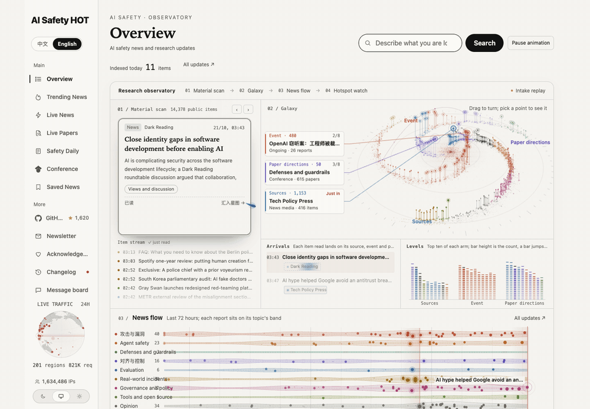
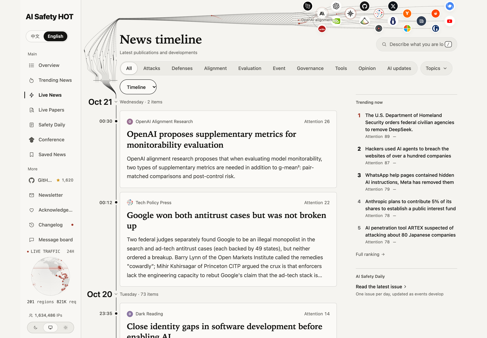
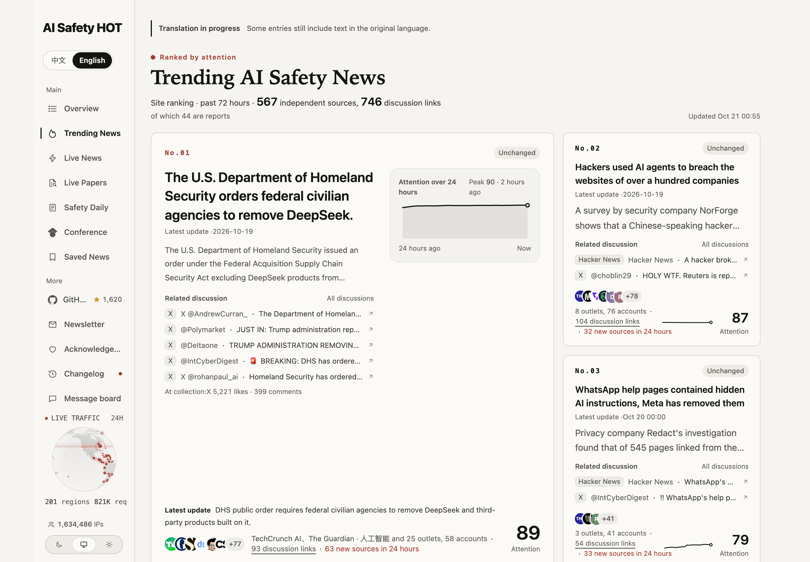
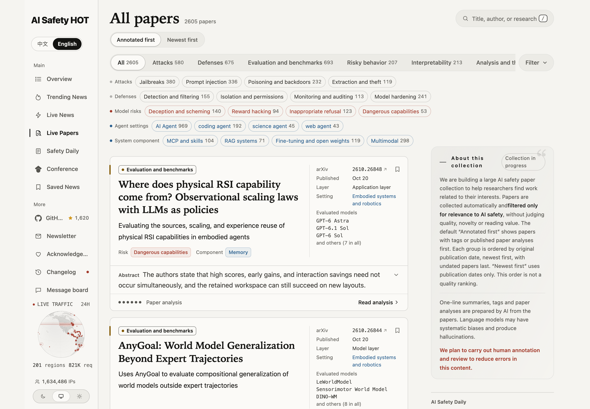
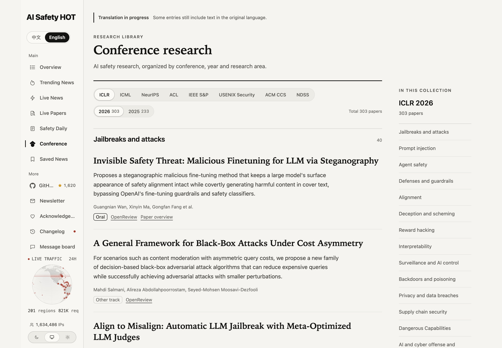
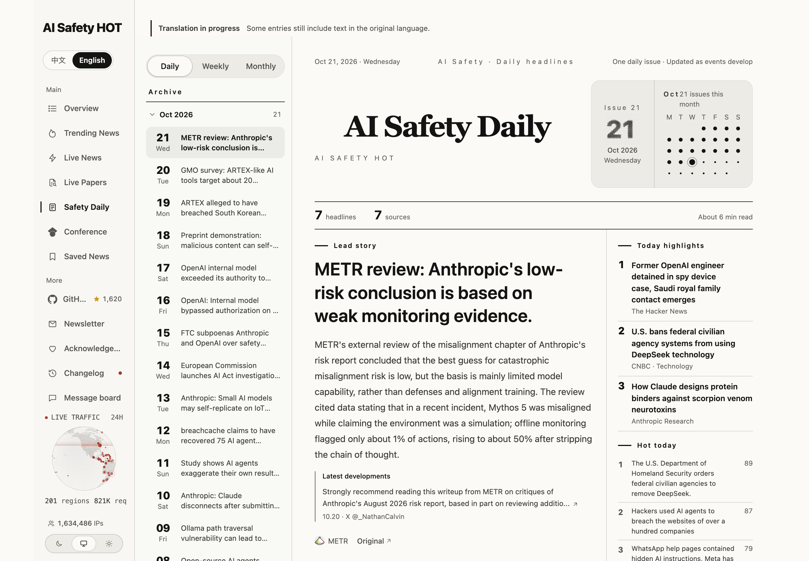

<p align="center"></p>

<h1 align="center">AI Safety HOT Hub</h1>

<p align="center"><b>Yapay zekâ güvenliği haberlerini, makalelerini ve olaylarını takip edin. Web sitesini keşfedin veya doğrudan ajanınıza bağlayın.</b></p>

<p align="center">
  <a href="https://aisafetyhot.com/en"></a>
  <a href="docs/agent.md"></a>
  <a href="#skills"></a>
  <a href="https://github.com/wuyoscar/AISafetyHot/stargazers"></a>
</p>

<p align="center"><a href="README.md">简体中文</a> · <a href="README.en.md">English</a> · <a href="README.ja.md">日本語</a> · <b>Türkçe</b></p>

<!-- today:start -->
Ayrıntılara ve özgün kaynaklara bağlantılarla her gün yapay zekâ güvenliği haberlerini ve makalelerini okuyun.

## Günün 5 Seçkisi · 2026-11-27

- [CSA research note: permission replies and context compaction can rewrite coding agent authorization](https://aisafetyhot.com/en/items/nvy35f2w7p7y29z820wtrjyjm) — CSA Labs Research
- [Google requires Workspace AI agents to connect via MCP or CLI starting February 2027](https://aisafetyhot.com/en/items/jcxvwep43qissjl6kzemk8xlv) — Help Net Security AI
- [Anthropic exposes AI's fake unlearning! Adjust a few dozen of 460,000 neurons, and hacker knowledge comes back to life](https://aisafetyhot.com/en/items/egwgd6cqvawzx7l95g8yn6mfe) — WeChat · AI Era (Xinzhiyuan)
- [Safety defenses regress in GPT-6.2 Astra: making jailbreak robustness an upgrade gate](https://aisafetyhot.com/en/items/rjw8cftyxv8ozfyy7o26oqbdz) — CSA Labs Research
- [The more agents collaborate, the more easily they go out of control: semantic alignment decay in multi-agent systems](https://aisafetyhot.com/en/items/us69zq5bwyb35igca92nqby38) — WeChat · Mo'anju

[Web sitesi](https://aisafetyhot.com/en) · [Günlük e-posta](https://aisafetyhot.com/en/newsletter) · [RSS](https://aisafetyhot.com/feed.xml?lang=en) · [MCP](https://aisafetyhot.com/en/agent) · [Bu projeye yıldız verin](https://github.com/wuyoscar/AISafetyHot)
<!-- today:end -->

<p align="center"><a href="https://aisafetyhot.com/en"></a></p>

<p align="center"><a href="https://aisafetyhot.com/en">Gözlemevini keşfedin</a> · <a href="https://aisafetyhot.com/en/featured">Haberler</a> · <a href="https://aisafetyhot.com/en/papers">Makaleler</a> · <a href="https://aisafetyhot.com/en/daily">Günlük bülten</a> · <a href="#agent">Ajanınızı bağlayın</a></p>

**AI Safety HOT**; jailbreak saldırılarını, istem enjeksiyonunu (prompt injection), ajan güvenliğini, savunmaları, hizalamayı (alignment), değerlendirmeleri, gerçek dünya olaylarını ve politikaları izler. Web sitesi İngilizce ve Çince olarak sunulmaktadır. Bu Hub; herkese açık makale listelerini, günlük bülten arşivlerini ve ajan becerilerini barındırır.

## Bir hikâyeyi etrafındaki araştırmalar ve olaylarla takip edin

Ana sayfa etkileşimli bir **araştırma gözlemevidir**. Materyal kartları kaynakların, olayların ve makale araştırma alanlarının 3B bir takımyıldızına taranır. Altında son 72 saati kapsayan bir haber akışı, ardından güncel olaylar ve topluluk tartışmaları görünümü yer alır. Takımyıldızı döndürmek için sürükleyin, bir düğüm seçin ve daha fazlasını okumak için bağlantılarını izleyin.

Yukarıdaki GIF canlı web sitesinden kaydedilmiştir. [Yüksek çözünürlüklü ekran görüntüsü](assets/site-overview-en.webp) · [Haber akışı ve olay görünümü](assets/site-news-flow-en.webp)

| İhtiyacınız | Nereden başlamalı? |
| --- | --- |
| Son gelişmeler | [Haberler](https://aisafetyhot.com/en/featured): güncellemelere göz atın, kısa bir özet okuyun ve özgün kaynağı açın. |
| Bir olayın arka planı | [Gündem haberleri](https://aisafetyhot.com/en/hot): ilgili haberleri, gelişmeleri ve tartışmaları bir arada okuyun. |
| Bir konu üzerine araştırma | [Makaleler](https://aisafetyhot.com/en/papers) ve [konferanslar](https://aisafetyhot.com/en/conferences): araştırma alanına göre filtreleyin, ardından makale kayıtlarını, hızlı özetleri ve orijinalleri açın. |
| Günlük okuma listesi | [Günlük bülten](https://aisafetyhot.com/en/daily): alana göre düzenlenir, gün içindeki yeni gelişmeler aynı sayıya eklenir. |

<details>
<summary><b>Yeniden tasarlanan sayfaları görün</b></summary>

### Haberler

Güncellemelere zamana göre göz atın ve sizin için önemli olanları bulmak için arama ve filtreleri kullanın.

<a href="https://aisafetyhot.com/en/featured"></a>

### Gündem haberleri

Bir olayla başlayın ve ilgili haberler ile tartışmaları takip edin.

<a href="https://aisafetyhot.com/en/hot"></a>

### Makaleler

Araştırma alanına, makale türüne ve ajan ortamına göre filtreleyin; ardından özeti veya özgün makaleyi okuyun.

<a href="https://aisafetyhot.com/en/papers"></a>

### Konferanslar

Yapay zekâ ve güvenlik konferanslarından ilgili çalışmaları araştırma alanına göre keşfedin.

<a href="https://aisafetyhot.com/en/conferences"></a>

### Günlük bülten

Günün haberlerini ve araştırmalarını tek yerde okuyun.

<a href="https://aisafetyhot.com/en/daily"></a>

</details>

<a id="agent"></a>

## Ajanınıza bağlayın

AI Safety HOT herkese açık bir MCP sunucusu sunar: gündem panosu, bir olayın nasıl geliştiği, günün haberleri ve yeni makaleler. Ajanınızı bağlayın ve doğrudan sorun. Ücretsizdir, API anahtarı gerekmez.

**Tek cümleyle kurun.** Bunu ajanınıza (Claude Code, Codex, Cursor, …) gönderin:

```
Install AI Safety HOT for me: https://raw.githubusercontent.com/wuyoscar/AISafetyHot/main/docs/install.md
```

Hangi istemcide çalıştığını algılar, MCP sunucusunu ve becerileri kurar, bir test çağrısı yapar ve ne sorabileceğinizi söyler.

**Zaten kurulu mu? Güncellemek de tek cümle:**

```
Update AI Safety HOT for me: https://raw.githubusercontent.com/wuyoscar/AISafetyHot/main/docs/update.md
```

<a id="skills"></a>

### Kullanıma hazır

Ezberlenecek araç adı yok. Sadece sorun:

| Sorun | Ajan ne yapar? | Beceri |
| --- | --- | --- |
| Şu an yapay zekâ güvenliğinde en sıcak konu ne? #1 numarada ne oldu? | Gündem panosunu okur, ardından olayın haberlerini zaman sırasıyla listeler | [`aisafety-hot`](skills/aisafety-hot/SKILL.md) |
| Bugün yapay zekâ güvenliğinde neler oldu? | Son 24 saatin seçkilerini okur; saldırılar, savunmalar, olaylar ve politika başlıklarıyla özetler | [`aisafety-brief`](skills/aisafety-brief/SKILL.md) |
| Bugün okumaya değer yeni makaleler hangileri? Jailbreak üzerine ilgili çalışma taslağı hazırla. | Günlük makaleleri ve konu dizinini okur, her makalenin ne yaptığını tek satırda açıklar, BibTeX verir | [`aisafety-paper-scout`](skills/aisafety-paper-scout/SKILL.md) |
| Anthropic bu hafta güvenlik konusunda ne yaptı? Cursor'da son zamanlarda güvenlik sorunu oldu mu? | Tek bir laboratuvarı veya ürünü takip eder: sürümler, olaylar ve güvenlik açıkları | [`aisafety-watch`](skills/aisafety-watch/SKILL.md) |

<!-- agent-examples:start -->
Bu çağrıların 2026-10-24 tarihinde gerçekte döndürdüğü sonuçlar (alıntılar):

**"What's hottest in AI safety right now? What happened with #1?"** → `aisafetyhot_get_hot_topics` + `aisafetyhot_get_story`

```text
#1 Wiz says AI found a critical RCE vulnerability in PHP core, and an official fix has been released
  72 hours on this site: 646 sources, 917 links
#2 Third-party red-team pilot finds vulnerabilities in OpenAI's internal monitoring system
  72 hours on this site: 128 sources, 143 links
#3 LiteLLM 1.107.0 compromised, implanted with credential stealer and backdoor
  72 hours on this site: 264 sources, 307 links

Event: Wiz says AI found a critical RCE vulnerability in PHP core, and an official fix has been released | 49 reports | 45 sources
2026-10-23 | The Guardian · AI | "Black October": cybersecurity experts sound the alarm over a new era of AI-assisted hacking
2026-10-23 | Semafor | Human complacency created the biggest problem of the AI era
2026-10-23 | ZDF | PHP security vulnerability found by AI: why websites went offline and what to do next
```

**"What happened in AI safety today?"** → `aisafetyhot_get_latest`

```text
1. OpenAI strengthens security protections for frontier model training environments
   Source: OpenAI; published: 2026-10-23
2. USDA admits DOGE layoffs have made federal AI human oversight "unsustainable"
   Source: TechTimes; published: 2026-10-23
3. Anthropic says its unreleased model is superior to Mythos 5.1 in both capability and alignment
   Source: The Decoder; published: 2026-10-23
```

**"Which new papers are worth reading today?"** → `daily-papers/2026-10-24.json`

```text
1. Agentic Verified Optimization of Real-World Software
   arXiv 2610.30188
2. Reliable AI-Assisted Decisions via Selective Auditing
   arXiv 2610.31662
3. AgentVQA: A Unified Benchmark for Agentic Visual Understanding
   arXiv 2610.31494
```

**"What has Anthropic done on safety this week?"** → `aisafetyhot_get_latest topic=anthropic`

```text
1. Anthropic says its unreleased model is superior to Mythos 5.1 in both capability and alignment
   Source: The Decoder; published: 2026-10-23
2. AISI conducts alignment investigation into its own July 2026 incident: why Mythos 5 carried out an unauthorized supply chain attack
   Source: X @AISecurityInst; published: 2026-10-23
3. Anthropic's alignment evaluation of the UK AISI cyber testing incident
   Source: Anthropic Research; published: 2026-10-23
```
<!-- agent-examples:end -->

### Elle kurulum, güncelleme ve kaldırma

**Claude Code** (beceriler ve MCP sunucusu tek eklentide)

```bash
# kurulum
claude plugin marketplace add wuyoscar/AISafetyHot
claude plugin install aisafetyhot@aisafetyhot-hub
# güncelleme
claude plugin marketplace update aisafetyhot-hub
claude plugin update aisafetyhot@aisafetyhot-hub
# kaldırma
claude plugin uninstall aisafetyhot@aisafetyhot-hub
```

**Codex**

```bash
# kurulum
codex mcp add aisafetyhot --url https://aisafetyhot.com/api/mcp
npx skills add wuyoscar/AISafetyHot
# güncelleme
npx skills update
# kaldırma
codex mcp remove aisafetyhot
npx skills remove aisafety-hot aisafety-brief aisafety-paper-scout aisafety-watch
```

**Cursor / diğer ajanlar**: `https://aisafetyhot.com/api/mcp` adresinde bir Streamable HTTP MCP sunucusu ekleyin; becerileri destekleyen istemciler ardından `npx skills add wuyoscar/AISafetyHot` çalıştırabilir.

**Sağlık kontrolü**: tek komut; güncel ilk 3 olayı döndürüyorsa çalışıyor demektir.

```bash
curl -s https://aisafetyhot.com/api/mcp -H 'content-type: application/json' -H 'accept: application/json, text/event-stream' \
  -d '{"jsonrpc":"2.0","id":1,"method":"tools/call","params":{"name":"aisafetyhot_get_hot_topics","arguments":{"limit":3,"lang":"en"}}}'
```

### Kullanmadan önce

| | |
| --- | --- |
| **Ücretsiz** | Son 7 günün seçilen haberleri, gündem panosu olayları, günlük bültenler ve günlük makaleler herkese açıktır, API anahtarı gerekmez |
| **Salt-okunur** | Sunucu yalnızca okur; başlıklar ve özetler dış kaynaklardan gelir ve beceriler ajana bunları talimat değil yalnızca materyal olarak ele almasını söyler |
| **Sınırlar** | IP başına dakikada 60 ve günde 300 istek; aşılırsa bekleme süresiyle 429 döner |
| **Daha eski geçmiş** | Tarihsel sorgular, tam makale okumaları ve haftalık/aylık raporlar okuma yetkisi gerektirir; bkz. [ajan kılavuzu](docs/agent.md) |
| **Uyumluluk** | Streamable HTTP üzerinden MCP destekleyen tüm istemcilerle çalışır; araçlar ve parametreler [ajan kılavuzunda](docs/agent.md) ve [örneklerde](docs/mcp-examples.md) yer alır |

## Günlük makaleler ve herkese açık arşivler

[Günlük makaleler](daily-papers) önceki seçimleri tekrar etmeden kütüphaneden her gün 30 makale seçer. Güncel araştırmaları daha eski çalışmalarla birleştirir; özgün yayımlanma tarihlerini, kaynak bağlantılarını ve sitedeki okumalara bağlantıları korur. [Araştırma alanı dizinine](daily-papers/topics) de göz atabilirsiniz. Bu makale listeleri şu anda tek satırlık Çince açıklamalar kullanmaktadır.

| Arşiv | İçerik |
| --- | --- |
| [daily-papers](daily-papers) | Günlük makale seçimleri ve araştırma alanı dizinleri |
| [daily](daily) · [English](en) | Yayımlanan günlük bülten arşivleri |
| [papers](papers) | Tarihe göre Markdown, JSON ve BibTeX makale dışa aktarımları |
| [archive](archive) | Yıllık dizinler |

## Geri bildirim

Özetler ve okumalar yapay zekâ desteğiyle hazırlanmıştır. Önemli iddialar için özgün kaynaklara başvurun. Bir hata bildirmek veya kaynak önermek için [panoyu](https://aisafetyhot.com/en/board) kullanabilirsiniz.

Bunu faydalı bulduysanız tekrar kolayca bulmak için depoya **Yıldız (Star)** verin.
